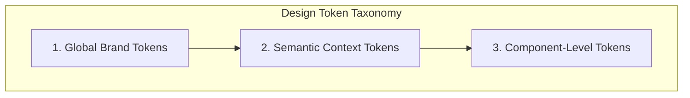

# Phase 3.2 — Design Token Audit & Formalization

> **Document Status:** LOCKED AUDIT BASELINE  
> **Phase:** 3 — UI/UX Audit (Step 3.2)  
> **Target Application:** AR Engineering & Construction Management (Laravel 13 + React 19 + Tailwind CSS v4)  
> **Audit Modality:** Deep Codebase CSS/JSX Static Inspection & Design Token Formalization  
> **Application Code Modifications:** NONE (Audit-only)

---

## 1. Executive Summary

This **Phase 3.2 Design Token Audit** formalizes, verifies, and catalogs the entire design token ecosystem of the AR Engineering web application. The audit examines the 8 core design token dimensions:
1. **Colors** (Brand, Semantic, Canvas/Surface, Text, Border, Feedback/Status)
2. **Typography** (Families, Size Scale, Line Heights, Weights, Tracking, Hierarchy)
3. **Spacing** (Scale, Section Rhythm, Page Margins, Card/Modal/Table Insets)
4. **Border Radius** (Scale, Buttons, Inputs, Cards, Badges, Modals)
5. **Shadows & Elevation** (Scale, Card Elevation, Modal Drop-Shadows, Glows)
6. **Container & Layout Widths** (Canvas Max-Widths, Form Bounds, Modal Dialog Limits)
7. **Breakpoints** (Responsive thresholds, Grid triggers, Navigation collapse)
8. **Component States** (Default, Hover, Focus / Focus-Visible, Active, Disabled, Error, Success)

### Core Architectural Discoveries & Inconsistencies
* **Dual Primary Color Identity Conflict (`[TOK-COL-01]` — HIGH):**  
  `--color-primary` is defined as `#111d23` (Deep Navy) in root CSS ([`resources/css/app.css:27`](file:///c:/Users/khademul/Herd/ar_frontend/resources/css/app.css#L27)), but re-declared as `#0284c7` (Sky Blue) within `.admin-body` ([`resources/css/app.css:147`](file:///c:/Users/khademul/Herd/ar_frontend/resources/css/app.css#L147)). This redefinition causes semantic token collision across shared components.
* **Disconnected UI Component Primitives (`[TOK-SYS-01]` — HIGH):**  
  The primitive components under [`resources/js/components/ui/`](file:///c:/Users/khademul/Herd/ar_frontend/resources/js/components/ui/) implement a dedicated token mapping (`cta`, `form`, `secondary`), but **none** of the 16 admin pages or 12 public pages consume these components, relying instead on fragmented inline Tailwind strings.
* **Non-Standard Font Sizing Scale (`[TOK-TYP-01]` — MEDIUM):**  
  The `@theme` typography definitions in [`resources/css/app.css:13-21`](file:///c:/Users/khademul/Herd/ar_frontend/resources/css/app.css#L13-L21) specify custom non-standard rem values (`--text-xs: 0.8125rem`, `--text-2xl: 1.55rem`, `--text-3xl: 2.05rem`, `--text-4xl: 2.75rem`) that conflict with standard 4px/8px proportional typographic scales.
* **Keyboard Focus Suppression (`[TOK-STA-01]` — HIGH):**  
  Over 80 form inputs across admin manager pages specify `focus:outline-none` accompanied only by `focus:border-primary` without a high-contrast focus ring (`focus-visible:ring-2`), failing WCAG 2.1 Focus Visible standards.

---

## 2. Category-by-Category Token Inventory & Conflict Analysis

```
┌────────────────────────────────────────────────────────────────────────────────────────┐
│                                TOKEN CATEGORY OVERVIEW                                │
├─────────────────────────┬─────────────────────────────┬────────────────────────────────┤
│ CATEGORY                │ IMPLEMENTATION MECHANISM    │ CONFLICT / INCONSISTENCY LEVEL │
├─────────────────────────┼─────────────────────────────┼────────────────────────────────┤
│ 1. Colors               │ CSS Variables (@theme)      │ HIGH (Split identity, Hex hardcodes)│
│ 2. Typography           │ CSS Variables + Base Rules  │ HIGH (Justify bug, non-standard scale)│
│ 3. Spacing              │ Custom Tokens + TW Defaults │ MEDIUM (Irregular section rhythm) │
│ 4. Border Radius        │ CSS Variables + TW Defaults │ LOW (Minor variant sprawl: 4–16px)│
│ 5. Shadows & Elevation  │ Standard TW Utilities       │ MEDIUM (Ad-hoc shadow combinations)│
│ 6. Container Widths     │ Custom Variable (1280px)    │ LOW (Consistent max-w-container-max)│
│ 7. Breakpoints          │ Tailwind CSS v4 defaults    │ LOW (Navbar breakpoint timing issue)│
│ 8. Component States     │ Inline Utility Classes      │ HIGH (Missing focus rings & spinners)│
└─────────────────────────┴─────────────────────────────┴────────────────────────────────┘
```

---

### 2.1 Colors

#### Verified Existing Codebase Inventory
In [`resources/css/app.css:26-73`](file:///c:/Users/khademul/Herd/ar_frontend/resources/css/app.css#L26-L73) and [`resources/css/app.css:131-150`](file:///c:/Users/khademul/Herd/ar_frontend/resources/css/app.css#L131-L150):

| Variable / Token | Declared Value (Root / Public) | Declared Value (`.admin-body`) | Verified Usage Context |
| :--- | :--- | :--- | :--- |
| `--color-primary` | `#111d23` (Navy) | `#0284c7` (Sky Blue) | Public headings/buttons; Admin buttons/accents |
| `--color-on-primary` | `#ffffff` | `#ffffff` | Button labels, inverted text |
| `--color-primary-container` | `#111d23` | *Not overridden* | Dark card containers |
| `--color-on-primary-container` | `#8d9aa1` | *Not overridden* | Container secondary text |
| `--color-secondary` | `#4c616c` (Technical Slate) | *Not overridden* | Body subheadings, muted descriptions |
| `--color-on-secondary` | `#ffffff` | *Not overridden* | Inverted secondary text |
| `--color-secondary-container` | `#cfe6f2` (Cyan tint) | *Not overridden* | Public badge/pill backgrounds |
| `--color-on-secondary-container` | `#526772` | *Not overridden* | Pill text color |
| `--color-tertiary` | `#ba1a1a` (Crimson Red) | *Not overridden* | Public primary CTA buttons |
| `--color-on-tertiary` | `#ffffff` | *Not overridden* | CTA button label |
| `--color-tertiary-container` | `#680008` | *Not overridden* | Inset containers |
| `--color-on-tertiary-container` | `#ff655c` | *Not overridden* | Alert text |
| `--color-midnight` | `#0c0f24` (Deep Blue-Black) | *Not overridden* | Public Navbar & Footer background |
| `--color-background` | `#f8f9fa` (Off-White) | `#0b1519` (Dark Slate Canvas) | Main page background |
| `--color-on-background` | `#191c1d` (Near Black) | `#e1e3e4` (High-contrast Off-White)| Body text |
| `--color-surface` | `#f8f9fa` | `#111d23` (Admin Surface Navy) | Card & panel backgrounds |
| `--color-on-surface` | `#191c1d` | `#e1e3e4` | Surface text |
| `--color-surface-dim` | `#d9dadb` | *Not overridden* | Subtle divider backgrounds |
| `--color-surface-bright` | `#f8f9fa` | *Not overridden* | Card highlights |
| `--color-surface-container-lowest` | `#ffffff` | `#0b1519` | Main content card surfaces |
| `--color-surface-container-low` | `#f3f4f5` | `#152229` | Table alternate rows, input backgrounds |
| `--color-surface-container` | `#edeeef` | `#19272f` | Card borders, dropdown panels |
| `--color-surface-container-high` | `#e7e8e9` | `#1d2c35` | Hovered card backgrounds |
| `--color-surface-container-highest`| `#e1e3e4` | `#22323c` | Active selected rows |
| `--color-on-surface-variant` | `#43474a` | `#c3c7ca` | Subtitle text, placeholder text |
| `--color-outline` | `#73787a` | `#8d9aa1` | Form input borders |
| `--color-outline-variant` | `#c3c7ca` | `#43474a` | Subtle container borders (`border-outline-variant/30`)|
| `--color-error` | `#ba1a1a` | *Not overridden* | Form validation errors, delete actions |
| `--color-error-container` | `#ffdad6` | *Not overridden* | Error alert background |
| `--color-on-error` | `#ffffff` | *Not overridden* | Error button text |
| `--color-on-error-container` | `#93000a` | *Not overridden* | Error alert text |

#### Verified Inconsistencies & Hardcoded Colors
1. **Ad-hoc Hex Values in Admin Views:**  
   - Black backdrop overlays hardcoded as `bg-[#000000]/80` across 8 modal dialogs ([`ServicesManager.jsx:623`](file:///c:/Users/khademul/Herd/ar_frontend/resources/js/admin/pages/ServicesManager.jsx#L623), [`CareersManager.jsx:524`](file:///c:/Users/khademul/Herd/ar_frontend/resources/js/admin/pages/CareersManager.jsx#L524), [`AboutManager.jsx:692`](file:///c:/Users/khademul/Herd/ar_frontend/resources/js/admin/pages/AboutManager.jsx#L692)).
   - Hardcoded badge colors: `bg-[#e0f2fe] text-[#0369a1]`, `bg-[#fef3c7] text-[#92400e]`, `bg-[#dcfce7] text-[#15803d]`.
2. **Dual Identity of `--color-primary`:**  
   - In Public portal: Primary represents **Navy Brand identity** (`#111d23`).
   - In Admin portal: Primary represents **Sky Blue action accent** (`#0284c7`).
   - *Impact:* A single `<Button variant="primary">` component cannot be shared between public and admin without inheriting diverging semantic behaviors.

---

### 2.2 Typography

#### Verified Existing Codebase Inventory
In [`resources/css/app.css:1-24`](file:///c:/Users/khademul/Herd/ar_frontend/resources/css/app.css#L1-L24) and [`resources/css/app.css:89-129`](file:///c:/Users/khademul/Herd/ar_frontend/resources/css/app.css#L89-L129):

| Token / Selector | Font Family | Size (Declared) | Equivalent Px | Weight | Line Height / Letter Spacing |
| :--- | :--- | :--- | :--- | :--- | :--- |
| `--font-sans` | `'Baloo Tammudu 2', ui-sans-serif` | Inherit | — | 400 | Normal |
| `--font-heading` | `'Baloo Tammudu 2', ui-sans-serif` | Inherit | — | 700 | `tracking-tight` (`-0.025em`) |
| `--font-body` | `'Baloo Tammudu 2', ui-sans-serif` | Inherit | — | 400 | Normal |
| `--font-mono` | `ui-monospace, SFMono-Regular, Menlo` | Inherit | — | 400 / 700 | `tracking-wider` / `tracking-widest` |
| `h1` (Base layer) | `'Baloo Tammudu 2'` | `3.5rem` | 56px | 700 (Bold) | `tracking-tight`, Uppercase |
| `h2` (Base layer) | `'Baloo Tammudu 2'` | `2.65rem` | 42.4px | 700 (Bold) | `tracking-tight`, Uppercase |
| `h3` (Base layer) | `'Baloo Tammudu 2'` | `1.95rem` | 31.2px | 700 (Bold) | `tracking-tight`, Uppercase |
| `h4` (Base layer) | `'Baloo Tammudu 2'` | `1.45rem` | 23.2px | 700 (Bold) | `tracking-tight`, Uppercase |
| `h5` (Base layer) | `'Baloo Tammudu 2'` | `1.15rem` | 18.4px | 700 (Bold) | `tracking-tight`, Uppercase |
| `--text-xs` | Theme token | `0.8125rem` | 13px | Inherit | — |
| `--text-sm` | Theme token | `0.9375rem` | 15px | Inherit | — |
| `--text-base` | Theme token | `1.0625rem` | 17px | Inherit | — |
| `--text-lg` | Theme token | `1.1875rem` | 19px | Inherit | — |
| `--text-xl` | Theme token | `1.25rem` | 20px | Inherit | — |
| `--text-2xl` | Theme token | `1.55rem` | 24.8px | Inherit | — |
| `--text-3xl` | Theme token | `2.05rem` | 32.8px | Inherit | — |
| `--text-4xl` | Theme token | `2.75rem` | 44px | Inherit | — |
| `--text-5xl` | Theme token | `3.5rem` | 56px | Inherit | — |

#### Verified Inconsistencies & Issues
1. **Global Text Justification (`[TYPO-01]` — HIGH):**  
   [`resources/css/app.css:173-197`](file:///c:/Users/khademul/Herd/ar_frontend/resources/css/app.css#L173-L197) sets `text-align: justify; text-justify: inter-word;` on `.rich-text`, `.rich-text-editor-body`, and individual paragraph tags, producing whitespace voids on desktop columns and narrow mobile screens.
2. **Non-Standard Font Step Scale:**  
   The scale skips standard Tailwind steps (12px, 14px, 16px, 18px, 20px, 24px, 30px, 36px, 48px) and defines fractional rem steps (13px, 15px, 17px, 19px, 24.8px, 32.8px, 44px).
3. **Monospace Overuse for Micro-Labels:**  
   Over 60% of all UI subheadings, badges, and button labels employ `font-mono text-xs uppercase tracking-widest`, creating visual tension with the rounded display font *Baloo Tammudu 2*.

---

### 2.3 Spacing Scale

#### Verified Existing Codebase Inventory
In [`resources/css/app.css:75-80`](file:///c:/Users/khademul/Herd/ar_frontend/resources/css/app.css#L75-L80):

| Variable / Token | Declared Value | Px Equivalent | Verified Implementation Usage |
| :--- | :--- | :--- | :--- |
| `--spacing-base-unit` | `4px` | 4px | Atomic base multiplier |
| `--spacing-margin-mobile` | `16px` | 16px | `px-margin-mobile` on public page wrappers |
| `--spacing-margin-desktop` | `48px` | 48px | `md:px-margin-desktop` on public page wrappers |
| `--spacing-gutter` | `24px` | 24px | Grid gap in 2/3 column public layouts |
| `--spacing-safe-area-ar` | `64px` | 64px | Hero header safe-offset |
| `--spacing-container-max` | `1280px` | 1280px | `max-w-container-max` (`1280px`) container wrapper |

#### Verified Inconsistencies
1. **Irregular Section Padding:**  
   - Homepage sections: `py-24` (96px).
   - Services index sections: `pt-16 pb-12` (64px / 48px).
   - About page sections: `py-16` (64px).
   - Contact / FAQ sections: `py-12` (48px) and `py-24` (96px).
2. **Admin Modal Form Padding:**  
   - Varied padding definitions: `p-4 sm:p-6 md:p-8` vs fixed `p-6` vs `p-4 sm:p-6` vs `p-3`.
3. **Table Cell Padding Variations:**  
   - `px-6 py-4` in `AboutManager.jsx` vs `p-3` in `HomepageManager.jsx` vs `py-3 px-4` in `ui/Table.jsx`.

---

### 2.4 Border Radius

#### Verified Existing Codebase Inventory
In [`resources/css/app.css:83-86`](file:///c:/Users/khademul/Herd/ar_frontend/resources/css/app.css#L83-L86):

| Token | CSS Value | Px Value | Usage Scope |
| :--- | :--- | :--- | :--- |
| `--radius-standard` | `4px` | 4px | Public cards, action buttons, filter buttons (`rounded`) |
| `--radius-lg` | `0.5rem` | 8px | Admin input fields, action buttons, table wrappers (`rounded-lg`) |
| `--radius-xl` | `0.75rem` | 12px | Admin cards, modal containers, settings panels (`rounded-xl`) |
| `rounded-2xl` (Tailwind) | `1rem` | 16px | Admin confirmation dialogs, stat cards |
| `--radius-full` | `9999px` | 9999px | Status badges, circular avatar containers (`rounded-full`) |

#### Verified Observations
* Public portal strictly adheres to crisp industrial geometry (`rounded` / 4px).
* Admin portal uses softer, modern rounded geometry (`rounded-lg` / 8px and `rounded-xl` / 12px).
* *Conclusion:* This dual-scale is architecturally sound if formalized as `radius-sm` (Public standard) vs `radius-md` / `radius-lg` (Admin dashboard standard).

---

### 2.5 Shadows & Elevation

#### Verified Existing Codebase Inventory
Implemented via Tailwind CSS utility classes:

| Utility Class | Shadow Formula / Elevation Level | Verified Usage Context |
| :--- | :--- | :--- |
| `shadow-none` | `none` | Mobile cards, un-elevated containers |
| `shadow-xs` / `shadow-sm` | `0 1px 2px 0 rgba(0, 0, 0, 0.05)` | Desktop card idle state (`shadow-none md:shadow-sm`), badges |
| `shadow-md` | `0 4px 6px -1px rgba(0, 0, 0, 0.1)` | Public card hover state (`md:hover:shadow-md`) |
| `shadow-lg` | `0 10px 15px -3px rgba(0, 0, 0, 0.1)` | Dropdown menus, floating search bars |
| `shadow-xl` | `0 20px 25px -5px rgba(0, 0, 0, 0.1)` | Admin edit forms (`shadow-xl`) |
| `shadow-2xl` | `0 25px 50px -12px rgba(0, 0, 0, 0.25)` | Admin modal dialogs (`shadow-2xl`) |

#### Verified Inconsistencies
* Modals use `shadow-2xl` combined with custom `backdrop-blur-sm` and `bg-[#000000]/80` without a standardized modal overlay token.

---

### 2.6 Container & Layout Widths

#### Verified Existing Codebase Inventory

| Token / Class | Exact Value | Usage Scope |
| :--- | :--- | :--- |
| `max-w-container-max` | `1280px` (`--spacing-container-max`) | Global public page layout boundary |
| `max-w-7xl` | `1280px` (80rem) | Admin main view container (`SystemCommands.jsx`) |
| `max-w-4xl` | `896px` (56rem) | Hero main heading, Large admin forms (`ServicesManager.jsx`) |
| `max-w-3xl` | `768px` (48rem) | Public lead paragraphs, Large image preview modal (`Portfolio.jsx`) |
| `max-w-2xl` | `672px` (42rem) | Section subtitle paragraphs, Admin profile forms (`Profile.jsx`) |
| `max-w-xl` | `576px` (36rem) | About description cards |
| `max-w-lg` | `512px` (32rem) | Standard CRUD edit modals (`CareersManager.jsx:525`) |
| `max-w-md` | `448px` (28rem) | Confirm dialogs, Service detail contact card |
| `max-w-sm` | `384px` (24rem) | Confirmation alerts, Mini filter dropdowns |

---

### 2.7 Breakpoints

#### Verified Existing Codebase Inventory
Tailwind CSS v4 standard responsive triggers:

| Breakpoint | Minimum Width | Verified Functional Purpose in Codebase |
| :--- | :--- | :--- |
| `sm:` | `640px` | 1-col $\to$ 2-col switch on stat grids, modal padding expansion (`sm:p-6`) |
| `md:` | `768px` | Mobile nav drawer toggle, public margin shift (`px-16px` $\to$ `px-48px`), card hover shadows |
| `lg:` | `1024px` | 2-col $\to$ 3-col service cards, admin sidebar desktop pin vs mobile drawer |
| `xl:` | `1280px` | Container maximum constraint reached (`max-w-container-max`) |
| `2xl:` | `1536px` | Ultra-wide displays (centered canvas with auto margins) |

#### Verified Issue
* **Public Navbar Dropdown Overlap at 1024px:**  
  The navigation bar collapses at `md` (768px), but between 768px and 1024px the 7 primary links and CTA button crowd the header, causing horizontal wrapping before `lg`.

---

### 2.8 Component States

#### Verified Existing Codebase Inventory

| State | Public Implementation Pattern | Admin Implementation Pattern | Status / Issue |
| :--- | :--- | :--- | :--- |
| **Default** | `bg-white border-outline-variant/30 text-on-surface` | `bg-background border-outline-variant/30 text-white` | Verified |
| **Hover** | `hover:border-primary md:hover:shadow-md hover:bg-opacity-90` | `hover:bg-surface-container hover:text-white` | Verified |
| **Focus** | `focus:border-primary focus:ring-1 focus:ring-primary` | `focus:border-primary focus:outline-none` | **High A11y Risk:** Missing visible focus ring in admin |
| **Active** | `active:translate-y-0 active:scale-95` | `active:bg-surface-container-highest` | Verified |
| **Disabled** | `disabled:opacity-30 disabled:hover:border-outline-variant` | `disabled:opacity-50 disabled:cursor-not-allowed` | Inconsistent opacity values (30% vs 50%) |
| **Error** | `border-error focus:border-error focus:ring-error text-error` | `border-error/50 text-error bg-error/10` | Verified |
| **Success** | `text-emerald-500 bg-emerald-500/10` | `text-green-400 bg-green-900/20` | Color divergence (emerald vs green) |

---

## 3. Token Conflict & Inconsistency Catalog

| Finding ID | Category | Severity | Issue Summary | Evidence (File & Line) | Impact | Recommendation |
| :--- | :--- | :--- | :--- | :--- | :--- | :--- |
| `[TOK-COL-01]` | Color | **HIGH** | Semantic collision on `--color-primary` (Navy `#111d23` vs Sky Blue `#0284c7`). | [`resources/css/app.css:27`](file:///c:/Users/khademul/Herd/ar_frontend/resources/css/app.css#L27) & [`app.css:147`](file:///c:/Users/khademul/Herd/ar_frontend/resources/css/app.css#L147) | Shared components cannot resolve consistent visual weight. | Decouple into `--brand-navy` and `--admin-accent-blue`. |
| `[TOK-COL-02]` | Color | **MEDIUM** | Hardcoded arbitrary hex colors in modal overlays and badges. | [`ServicesManager.jsx:623`](file:///c:/Users/khademul/Herd/ar_frontend/resources/js/admin/pages/ServicesManager.jsx#L623) (`bg-[#000000]/80`) | Bypasses theme engine; creates maintenance friction. | Replace with `--color-overlay-backdrop: rgba(0,0,0,0.8)`. |
| `[TOK-TYP-01]` | Typography | **HIGH** | Global `text-justify` rule breaks paragraph readability and letter spacing. | [`resources/css/app.css:173-197`](file:///c:/Users/khademul/Herd/ar_frontend/resources/css/app.css#L173-L197) | Severe visual river defects across short body copy. | Remove global `text-justify`; use standard `text-left`. |
| `[TOK-TYP-02]` | Typography | **MEDIUM** | Non-standard font size step scale (e.g. 13px, 15px, 17px, 24.8px). | [`resources/css/app.css:13-21`](file:///c:/Users/khademul/Herd/ar_frontend/resources/css/app.css#L13-L21) | Incompatible with standard 8px/4px typographic increments. | Standardize to canonical Tailwind / rem typographic scale. |
| `[TOK-SPA-01]` | Spacing | **MEDIUM** | Section vertical padding jumps inconsistently between 48px, 64px, and 96px. | Public pages (`Services.jsx:222`, `Portfolio.jsx:296`) | Fragmented vertical rhythm across public views. | Establish `--space-section-standard: 96px` and `--space-section-compact: 64px`. |
| `[TOK-STA-01]` | State | **HIGH** | Admin inputs use `focus:outline-none` with no high-contrast replacement ring. | [`AboutManager.jsx:332`](file:///c:/Users/khademul/Herd/ar_frontend/resources/js/admin/pages/AboutManager.jsx#L332), 80+ admin inputs | Fails WCAG 2.1 AA 2.4.7 Focus Visible criteria. | Enforce `focus-visible:ring-2 focus-visible:ring-primary-500`. |
| `[TOK-STA-02]` | State | **LOW** | Disabled state opacity is inconsistent (30% in `ui/Pagination` vs 50% in admin). | [`ui/Pagination.jsx:30`](file:///c:/Users/khademul/Herd/ar_frontend/resources/js/components/ui/Pagination.jsx#L30) | Inconsistent visual feedback for disabled controls. | Standardize disabled state to `disabled:opacity-40 disabled:cursor-not-allowed`. |
| `[TOK-SYS-01]` | System | **HIGH** | Centralized UI components in `components/ui/` are 100% unused. | [`components/ui/index.js`](file:///c:/Users/khademul/Herd/ar_frontend/resources/js/components/ui/index.js) (0 page imports) | Extreme code duplication; token updates do not propagate. | Adopt standard UI primitives across all views in Phase 4. |

---

## 4. Candidate Canonical Design Token System (RECOMMENDATION)

> [!NOTE]
> The following token specifications represent the **RECOMMENDED CANONICAL SYSTEM** for Phase 4 implementation. They are **NOT** active in the codebase.



### 4.1 Canonical Color Tokens

```css
/* ==========================================================================
   RECOMMENDED CANONICAL DESIGN TOKENS (Phase 4 Specification)
   ========================================================================== */

@theme {
    /* 1. Global Brand Primitives */
    --brand-navy-950: #0c0f24;    /* Midnight Navy */
    --brand-navy-900: #111d23;    /* Core Brand Navy */
    --brand-navy-800: #152229;
    --brand-navy-700: #19272f;
    --brand-slate-600: #4c616c;   /* Technical Slate */
    --brand-slate-500: #73787a;
    --brand-crimson-600: #ba1a1a; /* AR Engineering Crimson Accent */
    --brand-crimson-700: #93000a; /* Dark Crimson / Error */
    --brand-sky-500: #0284c7;     /* Admin Sky Blue Accent */
    --brand-sky-600: #0369a1;

    /* 2. Neutral Surface Primitives */
    --neutral-0: #ffffff;
    --neutral-50: #f8f9fa;
    --neutral-100: #f3f4f5;
    --neutral-200: #edeeef;
    --neutral-300: #e1e3e4;
    --neutral-400: #c3c7ca;
    --neutral-700: #43474a;
    --neutral-900: #191c1d;
    --neutral-950: #0b1519;

    /* 3. Semantic Tokens: Public Portal */
    --color-public-canvas: var(--neutral-50);
    --color-public-surface: var(--neutral-0);
    --color-public-surface-alt: var(--neutral-100);
    --color-public-text-main: var(--neutral-900);
    --color-public-text-muted: var(--brand-slate-600);
    --color-public-border-subtle: rgba(195, 199, 202, 0.3);
    --color-public-border-strong: var(--brand-navy-900);
    --color-public-cta: var(--brand-crimson-600);
    --color-public-cta-hover: var(--brand-crimson-700);

    /* 4. Semantic Tokens: Admin Portal */
    --color-admin-canvas: var(--neutral-950);
    --color-admin-surface: var(--brand-navy-900);
    --color-admin-surface-raised: var(--brand-navy-800);
    --color-admin-surface-elevated: var(--brand-navy-700);
    --color-admin-text-main: var(--neutral-300);
    --color-admin-text-muted: var(--neutral-400);
    --color-admin-border-subtle: rgba(67, 71, 74, 0.4);
    --color-admin-border-focus: var(--brand-sky-500);
    --color-admin-action: var(--brand-sky-500);
    --color-admin-action-hover: var(--brand-sky-600);
    --color-admin-danger: var(--brand-crimson-600);

    /* 5. Feedback & Status Tokens */
    --color-feedback-success-bg: rgba(22, 163, 74, 0.15);
    --color-feedback-success-text: #22c55e;
    --color-feedback-warning-bg: rgba(234, 179, 8, 0.15);
    --color-feedback-warning-text: #eab308;
    --color-feedback-error-bg: rgba(186, 26, 26, 0.15);
    --color-feedback-error-text: #ef4444;
    --color-feedback-info-bg: rgba(2, 132, 199, 0.15);
    --color-feedback-info-text: #38bdf8;
}
```

---

### 4.2 Canonical Typography Tokens

```css
@theme {
    /* Font Families */
    --font-family-display: 'Baloo Tammudu 2', ui-sans-serif, system-ui, sans-serif;
    --font-family-body: 'Inter', ui-sans-serif, system-ui, sans-serif;
    --font-family-mono: 'JetBrains Mono', ui-monospace, SFMono-Regular, monospace;

    /* Type Scale (Standard Rem) */
    --type-scale-xs: 0.75rem;    /* 12px */  --type-lh-xs: 1rem;      /* 16px */
    --type-scale-sm: 0.875rem;   /* 14px */  --type-lh-sm: 1.25rem;   /* 20px */
    --type-scale-base: 1rem;     /* 16px */  --type-lh-base: 1.5rem;  /* 24px */
    --type-scale-lg: 1.125rem;   /* 18px */  --type-lh-lg: 1.75rem;   /* 28px */
    --type-scale-xl: 1.25rem;    /* 20px */  --type-lh-xl: 1.75rem;   /* 28px */
    --type-scale-2xl: 1.5rem;    /* 24px */  --type-lh-2xl: 2rem;     /* 32px */
    --type-scale-3xl: 1.875rem;  /* 30px */  --type-lh-3xl: 2.25rem;  /* 36px */
    --type-scale-4xl: 2.25rem;   /* 36px */  --type-lh-4xl: 2.5rem;   /* 40px */
    --type-scale-5xl: 3rem;      /* 48px */  --type-lh-5xl: 1;
    --type-scale-6xl: 3.75rem;   /* 60px */  --type-lh-6xl: 1;

    /* Font Weights */
    --weight-regular: 400;
    --weight-medium: 500;
    --weight-semibold: 600;
    --weight-bold: 700;
}
```

---

### 4.3 Canonical Spacing, Radius & Elevation Tokens

```css
@theme {
    /* 8-Point Grid Spacing Tokens */
    --space-1: 0.25rem;  /* 4px */
    --space-2: 0.5rem;   /* 8px */
    --space-3: 0.75rem;  /* 12px */
    --space-4: 1rem;     /* 16px */
    --space-5: 1.25rem;  /* 20px */
    --space-6: 1.5rem;   /* 24px */
    --space-8: 2rem;     /* 32px */
    --space-10: 2.5rem;  /* 40px */
    --space-12: 3rem;    /* 48px */
    --space-16: 4rem;    /* 64px */
    --space-20: 5rem;    /* 80px */
    --space-24: 6rem;    /* 96px */

    /* Section Rhythm */
    --space-section-standard: var(--space-24); /* 96px */
    --space-section-compact: var(--space-16);  /* 64px */

    /* Border Radius */
    --radius-none: 0px;
    --radius-xs: 2px;
    --radius-sm: 4px;   /* Public standard */
    --radius-md: 6px;
    --radius-lg: 8px;   /* Admin standard */
    --radius-xl: 12px;  /* Dialog standard */
    --radius-full: 9999px;

    /* Elevation Shadows */
    --elevation-card-idle: 0 1px 3px 0 rgba(0, 0, 0, 0.08);
    --elevation-card-hover: 0 4px 6px -1px rgba(0, 0, 0, 0.12), 0 2px 4px -2px rgba(0, 0, 0, 0.08);
    --elevation-dropdown: 0 10px 15px -3px rgba(0, 0, 0, 0.15);
    --elevation-modal: 0 25px 50px -12px rgba(0, 0, 0, 0.35);

    /* Backdrop Overlays */
    --overlay-modal-backdrop: rgba(0, 0, 0, 0.75);
}
```

---

## 5. Existing Values $\to$ Proposed Canonical Tokens Mapping

| Existing Codebase Value / Pattern | Scope / Location | Proposed Canonical Token | Migration Path |
| :--- | :--- | :--- | :--- |
| `#111d23` | Root `--color-primary` | `--brand-navy-900` / `--color-public-border-strong` | Decouple from generic "primary" |
| `#0284c7` | Admin `.admin-body --color-primary` | `--brand-sky-500` / `--color-admin-action` | Isolate as admin action token |
| `#ba1a1a` | Root `--color-tertiary` | `--brand-crimson-600` / `--color-public-cta` | Map to explicit public CTA token |
| `#f8f9fa` | Root `--color-background` | `--color-public-canvas` | Standardize as public canvas |
| `#0b1519` | Admin `.admin-body --color-background` | `--color-admin-canvas` | Standardize as admin canvas |
| `bg-[#000000]/80` | Admin Modal backdrop overlays | `--overlay-modal-backdrop` | Replace hardcoded arbitrary class |
| `text-align: justify;` | `resources/css/app.css:173` | `text-align: left;` (`text-left`) | Remove global CSS justification rule |
| `0.8125rem` (13px) | `--text-xs` | `--type-scale-xs` (`0.75rem` / 12px) | Align to standard 12px small size |
| `0.9375rem` (15px) | `--text-sm` | `--type-scale-sm` (`0.875rem` / 14px) | Align to standard 14px small size |
| `1.0625rem` (17px) | `--text-base` | `--type-scale-base` (`1rem` / 16px) | Align to standard 16px base size |
| `py-8` / `py-12` / `py-16` / `py-24` | Public sections | `--space-section-standard` (96px) | Normalize section padding classes |
| `focus:outline-none` | Admin form inputs | `focus-visible:ring-2 focus-visible:ring-sky-500` | Add WCAG-compliant focus rings |
| Raw `<button>` strings | 16 Admin manager pages | `<Button variant="action">` | Consume standardized UI primitives |

---

## 6. Verification & Separation

- **VERIFIED OBSERVATIONS:**  
  All existing tokens, declared CSS variables in [`resources/css/app.css`](file:///c:/Users/khademul/Herd/ar_frontend/resources/css/app.css), inline Tailwind utility classes, hardcoded `#000000` overlays, and input state styles have been directly verified in the codebase.
- **RECOMMENDATIONS:**  
  All canonical tokens, naming schemes (`--brand-navy-900`, `--color-public-cta`), typography scale reconciliations, and focus ring standards are explicitly classified as **RECOMMENDATIONS** for Phase 4 implementation and remain **strictly unimplemented**.

---

## 7. Audit Results & Final Status

```
========================================
PHASE 3.2 STATUS
========================================
* Token categories audited: 8 (Colors, Typography, Spacing, Radius, Shadows, Containers, Breakpoints, States)
* Major conflicts found: 4 (Primary color collision, Global text-justify, Focus ring omission, Unused UI primitives)
* Number of findings by severity:
  - CRITICAL: 0
  - HIGH: 4 ([TOK-COL-01], [TOK-TYP-01], [TOK-STA-01], [TOK-SYS-01])
  - MEDIUM: 3 ([TOK-COL-02], [TOK-TYP-02], [TOK-SPA-01])
  - LOW: 1 ([TOK-STA-02])
  - Total Findings: 8
* Source code modified: NO
* Missing areas: None
* PHASE 3.2 STATUS: COMPLETE
========================================
```
