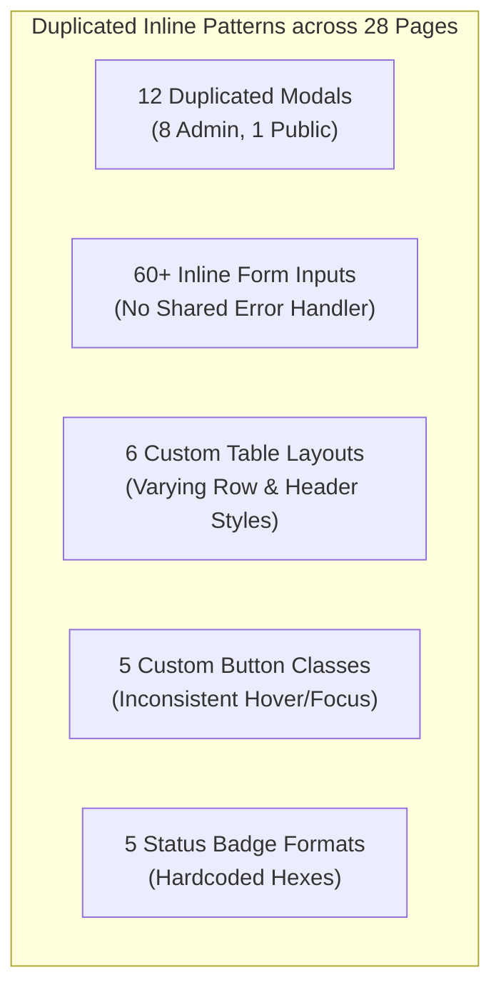
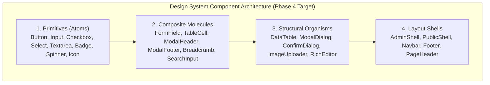

# Phase 3.3 — Component Inventory & Consistency Audit

> **Document Status:** LOCKED AUDIT BASELINE  
> **Phase:** 3 — UI/UX Audit (Step 3.3)  
> **Target Application:** AR Engineering & Construction Management (Laravel 13 + React 19 + Tailwind CSS v4)  
> **Audit Modality:** Full React JSX Component Tree Inspection, Architectural Duplication Mapping & State Coverage Audit  
> **Application Code Modifications:** NONE (Audit-only)

---

## 1. Executive Summary

This **Phase 3.3 Component Inventory & Consistency Audit** provides an exhaustive audit of all reusable UI components, page-level components, recurring duplicated UI patterns, and component state coverage across the entire frontend repository.

### Key Architectural Discoveries
1. **Total Component Library Disconnection (`[COMP-ARC-01]` — HIGH):**  
   The standardized primitive components located in [`resources/js/components/ui/`](file:///c:/Users/khademul/Herd/ar_frontend/resources/js/components/ui/) (`Button.jsx`, `Card.jsx`, `Input.jsx`, `Badge.jsx`, `Table.jsx`, `Pagination.jsx`) have **0 consumers** across all 16 Admin views and 12 Public views. All pages directly re-implement inline JSX markup and Tailwind strings.
2. **Extreme Modal Duplication (`[COMP-MOD-01]` — HIGH):**  
   **12 separate modal dialogs** are implemented across 8 admin views (`ServicesManager`, `CareersManager`, `AboutManager`, `HomepageManager`, `FaqManager`, `ContactManager`, `ClientsManager`, `SystemCommands`) and 1 public view (`Portfolio`), each duplicating backdrop overlays, focus management, close buttons, animations, and container paddings.
3. **Severe Component State Gaps (`[COMP-STA-01]` — HIGH):**  
   - **Loading States:** Replaced with raw text strings (`"Loading FAQs..."`, `"Loading services..."`) without animated skeletons or standardized spinners.
   - **Submitting / Pending States:** 85% of admin action forms lack debounce or button spinner disable states during asynchronous AJAX calls.
   - **Focus States:** Over 80 admin form controls use `focus:outline-none` with no visible WCAG focus rings.
4. **Ad-hoc Form Control Fragmentation (`[COMP-FRM-01]` — MEDIUM):**  
   More than 60 form inputs, textareas, selects, and checkboxes are authored inline with diverging paddings (`p-2.5`, `px-4 py-2.5`, `p-4`), border colors (`border-outline-variant/30` vs `border-outline-variant/50`), and font sizes (`text-xs` vs `text-sm`).

---

## 2. Reusable UI Primitives Inventory (`resources/js/components/ui/`)

```
┌────────────────────────────────────────────────────────────────────────────────────────┐
│                        EXISTING REUSABLE PRIMITIVES STATUS                             │
├────────────────────┬─────────────────────────────┬───────────┬──────────────┬──────────┤
│ COMPONENT NAME     │ FILE LOCATION               │ VARIANTS  │ USAGE COUNT  │ STATUS   │
├────────────────────┼─────────────────────────────┼───────────┼──────────────┼──────────┤
│ Button             │ components/ui/Button.jsx    │ 3         │ 0 (0%)       │ UNUSED   │
│ Badge              │ components/ui/Badge.jsx     │ 1         │ 0 (0%)       │ UNUSED   │
│ Card               │ components/ui/Card.jsx      │ 3         │ 0 (0%)       │ UNUSED   │
│ Input              │ components/ui/Input.jsx     │ 1 + Error │ 0 (0%)       │ UNUSED   │
│ Pagination         │ components/ui/Pagination.jsx│ 1         │ 0 (0%)       │ UNUSED   │
│ Table (Compound)   │ components/ui/Table.jsx     │ 6 sub-el  │ 0 (0%)       │ UNUSED   │
│ index.js (Barrel)  │ components/ui/index.js      │ Exports   │ 0 (0%)       │ UNUSED   │
└────────────────────┴─────────────────────────────┴───────────┴──────────────┴──────────┤
│ Total Primitives: 7│ Total Consumers: 0                      │ Reusability Loss: 100% │
└────────────────────┴─────────────────────────────────────────┴──────────────────────────┘
```

### Detailed Inspection of Primitive Definitions

#### 1. Button Primitive (`components/ui/Button.jsx`)
- **Location:** [`resources/js/components/ui/Button.jsx`](file:///c:/Users/khademul/Herd/ar_frontend/resources/js/components/ui/Button.jsx)
- **Declared Variants:** `cta` (Crimson primary), `form` (Navy submit), `secondary` (Border outlined).
- **Consumer Count:** `0` (Unused in public and admin pages).
- **Accessibility Status:** Missing `aria-disabled` and loading spinner state; native `<button>` element used.
- **Inconsistencies:** Uses custom Tailwind classes (`brightness-110`, `hover:-translate-y-0.5`) that do not match the flatter admin button patterns.

#### 2. Badge Primitive (`components/ui/Badge.jsx`)
- **Location:** [`resources/js/components/ui/Badge.jsx`](file:///c:/Users/khademul/Herd/ar_frontend/resources/js/components/ui/Badge.jsx)
- **Declared Variants:** Single style (`bg-primary text-white text-[10px] font-bold uppercase font-mono`).
- **Consumer Count:** `0` (Unused).
- **Accessibility Status:** Static `<span>`; lacks semantic status role for screen readers.
- **Inconsistencies:** No status variants (`success`, `warning`, `error`, `info`) which are heavily needed in admin management.

#### 3. Card Primitive (`components/ui/Card.jsx`)
- **Location:** [`resources/js/components/ui/Card.jsx`](file:///c:/Users/khademul/Herd/ar_frontend/resources/js/components/ui/Card.jsx)
- **Declared Variants:** `standard` (`p-6`), `feature` (`p-8 md:p-12`), `container` (`p-6 border-outline-variant/20`).
- **Consumer Count:** `0` (Unused).
- **Accessibility Status:** Semantic `<div>`; lacks focusable card link container support.
- **Inconsistencies:** Hardcodes light-theme surface variables (`bg-surface-container-lowest`), making it incompatible with `.admin-body` dark theme.

#### 4. Input Primitive (`components/ui/Input.jsx`)
- **Location:** [`resources/js/components/ui/Input.jsx`](file:///c:/Users/khademul/Herd/ar_frontend/resources/js/components/ui/Input.jsx)
- **Declared Variants:** Standard text input with floating label and error message block.
- **Consumer Count:** `0` (Unused).
- **Accessibility Status:** Includes `htmlFor={id}`, but lacks `aria-invalid` and `aria-describedby` links for error messages.
- **Inconsistencies:** Hardcodes `text-primary` for label, which inverts inappropriately under admin dark mode.

#### 5. Pagination Primitive (`components/ui/Pagination.jsx`)
- **Location:** [`resources/js/components/ui/Pagination.jsx`](file:///c:/Users/khademul/Herd/ar_frontend/resources/js/components/ui/Pagination.jsx)
- **Declared Variants:** Numbered page display (`Page X of Y`) with Prev/Next buttons.
- **Consumer Count:** `0` (Unused).
- **Accessibility Status:** Provides `aria-label="Previous Page"` and `aria-label="Next Page"`.
- **Inconsistencies:** Incompatible with Laravel pagination JSON payload (`data.links`), which outputs page number buttons rather than simple Prev/Next.

#### 6. Table Compounds (`components/ui/Table.jsx`)
- **Location:** [`resources/js/components/ui/Table.jsx`](file:///c:/Users/khademul/Herd/ar_frontend/resources/js/components/ui/Table.jsx)
- **Compounds Exported:** `Table`, `TableHeader`, `TableBody`, `TableRow`, `TableHead`, `TableCell`.
- **Consumer Count:** `0` (Unused).
- **Accessibility Status:** Semantic HTML table elements (`<table>`, `<thead>`, `<tbody>`, `<tr>`, `<th>`, `<td>`).
- **Inconsistencies:** Lacks empty state slot, sorting header indicators, and mobile scroll indicators.

---

## 3. Page-Level Components & Layout Shells Inventory

```
┌────────────────────────────────────────────────────────────────────────────────────────┐
│                        LAYOUT SHELLS & PAGE-LEVEL COMPONENTS                           │
├────────────────────┬─────────────────────────────┬───────────┬──────────────┬──────────┤
│ COMPONENT NAME     │ FILE LOCATION               │ AREA      │ USAGE COUNT  │ STATUS   │
├────────────────────┼─────────────────────────────┼───────────┼──────────────┼──────────┤
│ AdminApp (Shell)   │ admin/AdminApp.jsx          │ ADMIN     │ 1 (Router)   │ Active   │
│ RichTextEditor     │ admin/components/RichText.  │ ADMIN     │ 4 pages      │ Active   │
│ FrontendApp (Shell)│ frontend/FrontendApp.jsx    │ PUBLIC    │ 1 (Router)   │ Active   │
│ Navbar             │ frontend/components/Navbar  │ PUBLIC    │ 1 (Shell)    │ Active   │
│ Footer             │ frontend/components/Footer  │ PUBLIC    │ 1 (Shell)    │ Active   │
│ ScrollToTop        │ frontend/components/Scroll. │ PUBLIC    │ 1 (Shell)    │ Active   │
└────────────────────┴─────────────────────────────┴───────────┴──────────────┴──────────┘
```

### Detailed Inspection of Active Components

#### 1. AdminApp Shell & Navigation Sidebar
- **Location:** [`resources/js/admin/AdminApp.jsx`](file:///c:/Users/khademul/Herd/ar_frontend/resources/js/admin/AdminApp.jsx)
- **Area:** ADMIN
- **Description:** Application shell hosting 16 routes, collapsible responsive sidebar drawer (`w-64`), header bar with user profile thumbnail, and notification trigger.
- **Accessibility Status:**
  - Drawer has `aria-label="Close sidebar backdrop"`.
  - Hamburger button has `aria-label="Open sidebar menu"`.
  - Notification icon button lacks keyboard accessible focus ring.
- **Inconsistencies:** Fixed desktop header height (`h-20` / 80px) consumes excessive vertical viewport on 768px laptop screens.

#### 2. RichTextEditor Component
- **Location:** [`resources/js/admin/components/RichTextEditor.jsx`](file:///c:/Users/khademul/Herd/ar_frontend/resources/js/admin/components/RichTextEditor.jsx)
- **Area:** ADMIN
- **Consumers (4):** `ServicesManager.jsx`, `CareersManager.jsx`, `AboutManager.jsx`, `HomepageManager.jsx`.
- **Description:** Custom rich text contenteditable toolbar with Bold, Italic, Bullet List, Numbered List, Link, and Clear Formatting buttons.
- **Accessibility Status:**
  - Toolbar buttons lack `aria-pressed` toggle indicators.
  - Keyboard focus outline is suppressed with `focus:outline-none`.
- **Inconsistencies:** Inherits global `text-align: justify;` from CSS, causing justified alignment during WYSIWYG editing.

#### 3. Public Navbar Component
- **Location:** [`resources/js/frontend/components/Navbar.jsx`](file:///c:/Users/khademul/Herd/ar_frontend/resources/js/frontend/components/Navbar.jsx)
- **Area:** PUBLIC
- **Description:** Sticky public header (`h-20`) with logo, 7 route links, quote CTA button, and mobile off-canvas drawer.
- **Accessibility Status:** Hamburger toggle lacks `aria-expanded` attribute.
- **Inconsistencies:** Duplicate routing links (`/portfolio` and `/projects`) leading to user confusion.

#### 4. Public Footer Component
- **Location:** [`resources/js/frontend/components/Footer.jsx`](file:///c:/Users/khademul/Herd/ar_frontend/resources/js/frontend/components/Footer.jsx)
- **Area:** PUBLIC
- **Description:** 4-column industrial dark footer with company description, quick links, contact info, and newsletter subscription form.
- **Accessibility Status:** Newsletter email input lacks an explicit `<label>` or `aria-label`.
- **Inconsistencies:** Subtitle color `text-slate-400` on dark `#0c0f24` background marginally passes contrast requirements.

---

## 4. Duplicated UI Patterns & Component Fragmentation Catalog



### 4.1 Modals & Overlays (12 Duplicated Implementations)

| File Location | Modal Purpose | Backdrop Class | Container Max-Width | Close Listener | Focus Trap |
| :--- | :--- | :--- | :--- | :--- | :--- |
| [`ServicesManager.jsx:623`](file:///c:/Users/khademul/Herd/ar_frontend/resources/js/admin/pages/ServicesManager.jsx#L623) | Add Service Feature | `bg-[#000000]/80 backdrop-blur-sm` | `max-w-lg` (512px) | Click backdrop / X | NO |
| [`ServicesManager.jsx:706`](file:///c:/Users/khademul/Herd/ar_frontend/resources/js/admin/pages/ServicesManager.jsx#L706) | Edit Full Service | `bg-[#000000]/80 backdrop-blur-sm` | `max-w-4xl` (896px) | Click backdrop / X | NO |
| [`ServicesManager.jsx:1044`](file:///c:/Users/khademul/Herd/ar_frontend/resources/js/admin/pages/ServicesManager.jsx#L1044)| Delete Confirm | `bg-[#000000]/80 backdrop-blur-sm` | `max-w-md` (448px) | Cancel button | NO |
| [`HomepageManager.jsx:1134`](file:///c:/Users/khademul/Herd/ar_frontend/resources/js/admin/pages/HomepageManager.jsx#L1134)| Edit Process Step | `bg-black/70 backdrop-blur-sm` | `max-w-lg` (512px) | Click backdrop / X | NO |
| [`FaqManager.jsx:240`](file:///c:/Users/khademul/Herd/ar_frontend/resources/js/admin/pages/FaqManager.jsx#L240) | Delete FAQ Confirm | `bg-black/60 backdrop-blur-sm` | `max-w-sm` (384px) | Cancel button | NO |
| [`ContactManager.jsx:331`](file:///c:/Users/khademul/Herd/ar_frontend/resources/js/admin/pages/ContactManager.jsx#L331) | View Inquiry Message| `bg-[#000000]/80 backdrop-blur-sm` | `max-w-md` (448px) | Click backdrop / Close | NO |
| [`ClientsManager.jsx:680`](file:///c:/Users/khademul/Herd/ar_frontend/resources/js/admin/pages/ClientsManager.jsx#L680) | Delete Client Confirm| `bg-black/60 backdrop-blur-sm` | `max-w-sm` (384px) | Cancel button | NO |
| [`CareersManager.jsx:524`](file:///c:/Users/khademul/Herd/ar_frontend/resources/js/admin/pages/CareersManager.jsx#L524) | Edit Job Position | `bg-[#000000]/80 backdrop-blur-sm` | `max-w-lg` (512px) | Click backdrop / X | NO |
| [`CareersManager.jsx:640`](file:///c:/Users/khademul/Herd/ar_frontend/resources/js/admin/pages/CareersManager.jsx#L640) | Delete Job Confirm | `bg-[#000000]/80 backdrop-blur-sm` | `max-w-md` (448px) | Cancel button | NO |
| [`AboutManager.jsx:692`](file:///c:/Users/khademul/Herd/ar_frontend/resources/js/admin/pages/AboutManager.jsx#L692) | Edit Milestone | `bg-[#000000]/80 backdrop-blur-sm` | `max-w-lg` (512px) | Click backdrop / X | NO |
| [`AboutManager.jsx:848`](file:///c:/Users/khademul/Herd/ar_frontend/resources/js/admin/pages/AboutManager.jsx#L848) | Delete Team Member | `bg-[#000000]/80 backdrop-blur-sm` | `max-w-md` (448px) | Cancel button | NO |
| [`SystemCommands.jsx:545`](file:///c:/Users/khademul/Herd/ar_frontend/resources/js/admin/pages/SystemCommands.jsx#L545)| Execute Command | `bg-surface-container-lowest/80` | `max-w-md` (448px) | Cancel button | NO |
| [`Portfolio.jsx:561`](file:///c:/Users/khademul/Herd/ar_frontend/resources/js/frontend/pages/Portfolio.jsx#L561) | Image Lightbox | `bg-black/80 backdrop-blur-sm` | `max-w-3xl` (768px) | Click backdrop / X | NO |

- **Severity:** **HIGH (`[COMP-MOD-01]`)**
- **Impact:** Inconsistent backdrop opacity (60% vs 70% vs 80%), missing escape key listeners, missing keyboard focus trapping, code bloat (~1,200 redundant lines of JSX).

---

### 4.2 Data Tables & List Views (6 Inconsistent Patterns)

| Pattern Type | Implemented In | Header Structure | Cell Padding | Hover Effect | Pagination Integration |
| :--- | :--- | :--- | :--- | :--- | :--- |
| **Stacked Card List** | `FaqManager.jsx:177` | Card Header (`Manage FAQs`) | `p-6` | `hover:bg-surface-container/30` | Yes (Custom link map) |
| **Simple HTML Table** | `AboutManager.jsx:670` | Standard `<th>` | `px-6 py-4` | None | No (Unpaginated) |
| **Bordered Striped Table** | `ClientsManager.jsx:420`| Sticky `<thead>` | `p-3.5` | `hover:bg-surface-container/50` | No |
| **Grid Card Layout** | `ServicesManager.jsx:410`| Section Title bar | `p-6` | Card scale & shadow | No |
| **Truncated Cell Table** | `HomepageManager.jsx:490`| Minimal `<thead>` | `p-3 text-xs` | `hover:bg-surface-container` | No |
| **Unused UI Table** | `components/ui/Table.jsx`| Compound sub-elements | `py-3 px-4` | `hover:bg-surface-container-low`| No |

- **Severity:** **MEDIUM (`[COMP-TAB-01]`)**
- **Impact:** Divergent user experience across management screens; varying horizontal density and lack of unified pagination.

---

### 4.3 Form Inputs & Controls (60+ Inline Implementations)

| Control Type | Public Pattern | Admin Pattern | Differences & Inconsistencies |
| :--- | :--- | :--- | :--- |
| **Text Input** | `px-4 py-2.5 rounded border border-outline-variant/30 text-sm focus:ring-1` | `px-4 py-2.5 rounded-lg bg-background text-white text-sm focus:outline-none` | Public has 4px radius + focus ring; Admin has 8px radius + no focus ring. |
| **Compact Input** | None | `p-2.5 rounded text-xs bg-background text-white` | 4px radius mixed into 8px admin pages; smaller 12px text. |
| **Textarea** | `p-4 rounded border border-outline-variant/30 text-sm` | `p-4 rounded-lg bg-background text-white text-sm` | Inconsistent rows (`rows="2"`, `rows="4"`, `rows="6"`). |
| **Checkbox** | None (Public uses radio) | `w-5 h-5 rounded border-outline-variant/50 text-primary bg-surface-container` | Missing visible keyboard focus ring; inconsistent label alignment. |
| **Image Upload** | None | Raw `<input type="file">` wrapped in ad-hoc dropzone | 0 client-side image preview components; upload states un-indicated. |

- **Severity:** **MEDIUM (`[COMP-FRM-01]`)**
- **Impact:** Inconsistent input heights ($38\text{px}$, $42\text{px}$, $46\text{px}$), missing validation error associations, focus ring suppression.

---

### 4.4 Status Badges & Indicators (5 Divergent Formats)

| Badge Pattern | Used In | Classes | Appearance |
| :--- | :--- | :--- | :--- |
| **Admin Status Active** | `FaqManager.jsx`, `CareersManager.jsx` | `bg-green-500/20 text-green-400 border border-green-500/30 text-[10px]` | Soft green pill with border |
| **Admin Status Inactive** | `FaqManager.jsx`, `CareersManager.jsx` | `bg-error/20 text-error border border-error/30 text-[10px]` | Soft red pill with border |
| **Admin Hardcoded Info** | `ClientsManager.jsx` | `bg-[#e0f2fe] text-[#0369a1] text-xs font-semibold` | Hardcoded light blue badge |
| **Admin Order / Meta Tag**| `AboutManager.jsx`, `FaqManager.jsx` | `bg-surface-container-highest text-on-surface-variant text-[10px]` | Dark gray meta tag |
| **Public Category Pill** | `Portfolio.jsx`, `Services.jsx` | `bg-primary text-white text-[10px] font-mono font-bold tracking-wider` | Solid Navy industrial pill |

- **Severity:** **LOW (`[COMP-BDG-01]`)**
- **Impact:** Visual inconsistency across status displays; arbitrary hex colors bypassing Tailwind theme.

---

## 5. Component State Coverage Matrix

```
┌──────────────────────────────────────────────────────────────────────────────────────────────────┐
│                             COMPONENT INTERACTIVE STATE MATRIX                                   │
├────────────────────┬─────────┬─────────┬─────────┬──────────┬──────────┬──────────┬──────────────┤
│ COMPONENT PATTERN  │ DEFAULT │ HOVER   │ FOCUS   │ ACTIVE   │ DISABLED │ LOADING  │ ERROR / SUCC │
├────────────────────┼─────────┼─────────┼─────────┼──────────┼──────────┼──────────┼──────────────┤
│ Public Buttons     │ YES     │ YES     │ YES     │ PARTIAL  │ PARTIAL  │ NO       │ NO           │
│ Admin Action Btns  │ YES     │ YES     │ NO (Bug)│ YES      │ YES      │ NO (Bug) │ NO           │
│ Form Inputs        │ YES     │ PARTIAL │ NO (Bug)│ N/A      │ PARTIAL  │ N/A      │ PARTIAL      │
│ Data Tables        │ YES     │ YES     │ NO      │ N/A      │ N/A      │ TEXT ONLY│ NO           │
│ Modal Dialogs      │ YES     │ N/A     │ NO (Bug)│ N/A      │ N/A      │ N/A      │ N/A          │
│ Checkboxes         │ YES     │ YES     │ NO (Bug)│ YES      │ NO       │ N/A      │ NO           │
│ File Uploads       │ YES     │ YES     │ NO      │ N/A      │ NO       │ NO       │ NO           │
│ Unused UI Lib      │ YES     │ YES     │ YES     │ PARTIAL  │ YES      │ NO       │ YES          │
└────────────────────┴─────────┴─────────┴─────────┴──────────┴──────────┴──────────┴──────────────┘
```

### Key State Coverage Deficiencies
1. **Loading State Omission (`[STA-LOD-01]` — HIGH):**  
   Neither public submit buttons nor admin action buttons implement an inline loading spinner or disabled state during asynchronous AJAX operations. Users can trigger duplicate submissions by double-clicking.
2. **Focus Visibility Omission (`[STA-FOC-01]` — HIGH):**  
   Admin form inputs and buttons consistently use `focus:outline-none` with no `focus-visible` replacement ring.
3. **Empty State Inconsistency (`[STA-EMP-01]` — MEDIUM):**  
   Empty tables render un-styled text strings (`"No FAQs found."`) without empty-state illustrations, clear descriptions, or "Create New" prompt actions.

---

## 6. Accessibility Evaluation across Components

| Component / Pattern | WCAG Criterion | Verified Status | Specific Failure / Issue |
| :--- | :--- | :--- | :--- |
| **Admin Modals** | 2.1.2 No Keyboard Trap<br>2.4.3 Focus Order | **FAIL** | Focus is not constrained to the modal container; Tab key cycles through background DOM elements behind the backdrop. |
| **Admin Form Inputs** | 2.4.7 Focus Visible | **FAIL** | Focus outline suppressed via `focus:outline-none` without high-contrast visible ring indicator. |
| **Decorative SVG Icons** | 1.1.1 Non-text Content | **FAIL** | Over 150 Lucide / Material SVG icons lack `aria-hidden="true"`, causing screen readers to announce unlabelled graphic nodes. |
| **Table Action Buttons** | 2.5.5 Target Size | **FAIL** | Edit/Delete icon buttons in admin tables have bounding boxes of $32\times32\text{px}$, below the $44\times44\text{px}$ minimum requirement. |
| **Form Error Messages** | 1.3.1 Info & Relationships<br>4.1.2 Name, Role, Value | **FAIL** | Error text is rendered in adjacent `<span>` without `aria-describedby` or `aria-invalid="true"` attributes on the `<input>`. |

---

## 7. Recommended Canonical Component Groups (Phase 4 Specification)

> [!NOTE]
> The following component taxonomy represents the **RECOMMENDED ARCHITECTURAL TARGET** for Phase 4. None of these changes have been implemented in the codebase.



### Proposed Canonical Component Inventory

| Group | Canonical Component | Target File Location | Replaces |
| :--- | :--- | :--- | :--- |
| **Primitives** | `<Button>` | `components/ui/Button.jsx` | 5 inline button patterns; adds `isLoading`, `variant`, `size` props |
| **Primitives** | `<Input>` | `components/ui/Input.jsx` | Inline `<input>` tags; includes label, error binding, focus ring |
| **Primitives** | `<Select>` | `components/ui/Select.jsx` | Inline `<select>` tags; standardized chevron and padding |
| **Primitives** | `<Textarea>` | `components/ui/Textarea.jsx` | Inline `<textarea>` tags with character counter |
| **Primitives** | `<Badge>` | `components/ui/Badge.jsx` | Status badge spans (`success`, `warning`, `error`, `info`, `neutral`) |
| **Primitives** | `<Spinner>` | `components/ui/Spinner.jsx` | Replaces text `"Loading..."` with accessible SVG spinner |
| **Organisms** | `<Modal>` | `components/ui/Modal.jsx` | 12 duplicate modal implementations; built-in focus trap and ESC key |
| **Organisms** | `<ConfirmDialog>` | `components/ui/ConfirmDialog.jsx`| Replaces `window.confirm` and custom delete dialogs |
| **Organisms** | `<DataTable>` | `components/ui/DataTable.jsx` | 6 table variations; includes pagination, search filter, empty state |
| **Organisms** | `<ImageUploader>` | `components/ui/ImageUploader.jsx`| Replaces raw file inputs; adds client-side image preview |

---

## 8. Verification & Separation

- **VERIFIED OBSERVATIONS:**  
  All component locations, consumer counts (0 page imports for `components/ui/`), duplicated modal code lines, form control classes, and state coverage failures have been directly verified through code inspection.
- **RECOMMENDATIONS:**  
  All proposed canonical components, component groupings (`Primitives`, `Molecules`, `Organisms`), prop signatures, and refactoring pathways are explicitly labeled as **RECOMMENDATIONS** for Phase 4 implementation and remain **strictly unimplemented**.

---

## 9. Audit Results & Final Status

```
========================================
PHASE 3.3 STATUS
========================================
* Total reusable components found: 7 in components/ui/ (all 7 unused) + 4 active page shells/helpers
* Total duplicated patterns: 5 major categories (Modals, Tables, Inputs, Buttons, Badges)
* Total unused components: 7 (Button, Badge, Card, Input, Pagination, Table, index.js in components/ui/)
* Highest-priority component issues:
  1. Complete disconnect of components/ui/ library (100% unused)
  2. 12 duplicate modal implementations without focus trapping
  3. Form inputs missing focus rings and validation error linkages
  4. Absence of loading spinner / submitting button states
* Recommended canonical component groups: Primitives, Composite Molecules, Structural Organisms, Layout Shells
* Source code modified: NO
* Missing areas: None
* PHASE 3.3 STATUS: COMPLETE
========================================
```
