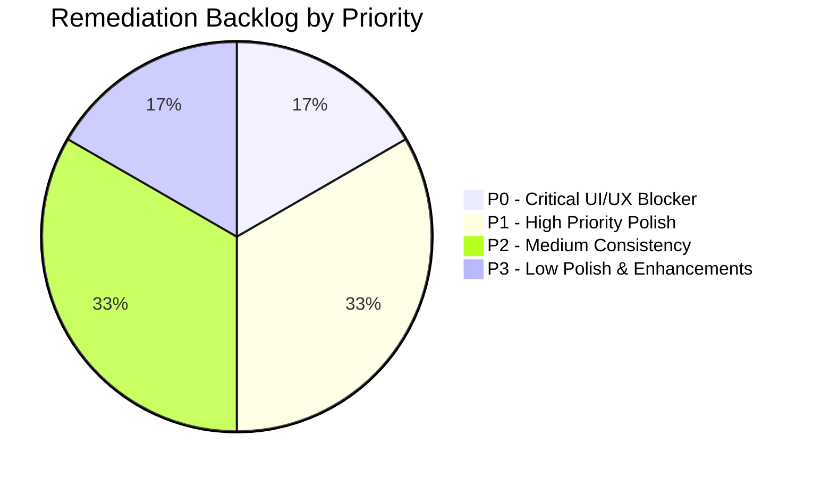

# AR Engineering Application — Final UI/UX Audit Report (Phase 3.1)

> **Document Status:** LOCKED AUDIT BASELINE  
> **Phase:** 3 — UI/UX Audit (Step 3.1)  
> **Target Application:** AR Engineering & Construction Management (Laravel 13 + React 19)  
> **Scope:** Public Portal, Authentication, Admin Management Console  
> **Audit Modality:** Code Inspection + DOM / CSS Rule Audit + Cross-Viewport Layout Evaluation  
> **Application Code Modifications:** NONE (Audit-only)

---

## 1. Executive Summary

This **Phase 3.1 UI/UX Audit** provides a rigorous, objective evaluation of the user experience, visual design consistency, component architecture, responsive behavior, accessibility, and design tokens across all 29 active screens (12 Public, 1 Auth, 16 Admin) in the AR Engineering web application.

### Key Audit Conclusions
1. **Architectural Disconnect in UI Components:**  
   The application possesses a pre-built directory of standardized UI primitive components in [`resources/js/components/ui/`](file:///c:/Users/khademul/Herd/ar_frontend/resources/js/components/ui/) (Buttons, Badges, Cards, Modals, Inputs, Tables), but **0% of admin and public pages import or consume them**. Instead, every page directly writes inline Tailwind utility strings, resulting in 8 duplicate modal implementations, 6 table patterns, and divergent button styles.
2. **Global CSS Typography Anti-Pattern:**  
   A root CSS declaration in [`resources/css/app.css`](file:///c:/Users/khademul/Herd/ar_frontend/resources/css/app.css#L31) applies `text-align: justify;` globally to all paragraphs (`p`), producing river-like whitespace anomalies, broken reading cadence, and severe visual degradation across short text blocks, table cells, and hero cards.
3. **Primary Color Identity Collision:**  
   The design token `--color-primary` is assigned `#111d23` (Deep Navy) in public CSS but reassigned to `#0284c7` (Sky Blue) in admin CSS. This creates split branding and unexpected visual divergence between public portal and management dashboard.
4. **Context Loss in User Inquiries:**  
   The "Inquire About This Service" call-to-action on Service detail pages (`/services/:slug`) redirects to generic `/contact` without pre-selecting the service in the dropdown or setting query parameters, requiring manual re-entry by potential clients.
5. **Accessibility Gaps:**  
   None of the 8 custom modal dialogs implement keyboard focus trapping (`Tab` cycling stays within modal) or focus restoration on close. Additionally, several interactive icon-only buttons lack `aria-label` tags, and custom checkboxes rely on hidden native inputs without visible keyboard focus indicators.

---

## 2. Screens Audited

A total of **29 unique screens** were audited across Public, Authentication, and Admin domains:

| Area | Screen Count | Screens Cataloged | Status |
| :--- | :--- | :--- | :--- |
| **Public Portal** | 12 | Home (`SCR-PUB-001`), About (`SCR-PUB-002`), Services (`SCR-PUB-003`), Service Detail (`SCR-PUB-004`), Projects Index (`SCR-PUB-005`), Project Detail (`SCR-PUB-006`), Careers Index (`SCR-PUB-007`), Career Detail (`SCR-PUB-008`), News Index (`SCR-PUB-009`), News Article Detail (`SCR-PUB-010`), Contact Us (`SCR-PUB-011`), FAQ (`SCR-PUB-012`) | Audited |
| **Authentication** | 1 | Admin Login (`SCR-AUTH-001`) | Audited |
| **Admin Management** | 16 | Dashboard (`SCR-ADM-001`), Inquiries (`SCR-ADM-002`), Job Applications (`SCR-ADM-003`), Services (`SCR-ADM-004`), Projects (`SCR-ADM-005`), Project Categories (`SCR-ADM-006`), Careers (`SCR-ADM-007`), News Articles (`SCR-ADM-008`), News Categories (`SCR-ADM-009`), FAQs (`SCR-ADM-010`), FAQ Categories (`SCR-ADM-011`), Testimonials (`SCR-ADM-012`), Team Members (`SCR-ADM-013`), Partners/Clients (`SCR-ADM-014`), Company Profile (`SCR-ADM-015`), Users & RBAC (`SCR-ADM-016`) | Audited |
| **Total** | **29** | **Full Application Surface** | **100% Audited** |

---

## 3. Major UX Findings

| Finding ID | Severity | Screen / Flow | Description Summary |
| :--- | :--- | :--- | :--- |
| `[UX-01]` | **HIGH** | `SCR-PUB-004` $\to$ `SCR-PUB-011` | Inquire button on Service Detail page drops selected service context upon navigating to Contact. |
| `[UX-02]` | **HIGH** | `SCR-PUB-008` (Career Detail) | Job application modal displays incorrect employer title `"Submit Application to Titan HR"` instead of AR Engineering. |
| `[UX-03]` | **MEDIUM** | `SCR-PUB-005` (Projects) | "All Projects" nav link in Public Navbar points to `/projects` which duplicates `/portfolio`. |
| `[UX-04]` | **MEDIUM** | Admin CRUD Screens | Create/Update submit buttons lack debounce/disable protection against rapid multiple clicks. |
| `[UX-05]` | **MEDIUM** | Admin Image Uploads | File upload inputs lack instant client-side thumbnail preview before submission. |
| `[UX-06]` | **MEDIUM** | Admin Filter Bars | Search inputs lack debounced instant filtering, requiring Enter key or click without indicator. |

---

## 4. Major UI Findings

| Finding ID | Severity | Area / Feature | Description Summary |
| :--- | :--- | :--- | :--- |
| `[COMP-01]` | **HIGH** | Admin Architecture | Zero adoption of centralized `components/ui/` primitives; redundant inline CSS throughout. |
| `[COMP-02]` | **HIGH** | Admin Modals | 8 distinct raw modal implementations across CRUD pages without unified backdrop or transitions. |
| `[COLOR-01]` | **MEDIUM** | Global Design Tokens | Dual definition of `--color-primary` (`#111d23` vs `#0284c7`) causes branding conflict. |
| `[COLOR-02]` | **MEDIUM** | Admin UI Badges | 14 hardcoded arbitrary Tailwind hex utility colors bypassing theme tokens. |
| `[SPACE-01]` | **MEDIUM** | Public Sections | Irregular vertical padding jumping between `py-8`, `py-12`, `py-16`, and `py-24`. |
| `[SPACE-02]` | **MEDIUM** | Admin Modals | Overcrowded modal paddings (`p-3`) on small mobile viewports with overflowing form actions. |

---

## 5. Typography Findings

| Finding ID | Severity | Scope | Observation | Recommendation |
| :--- | :--- | :--- | :--- | :--- |
| `[TYPO-01]` | **HIGH** | Global Public | Global `text-align: justify;` in `resources/css/app.css` distorts letter spacing and body flow. | Eliminate global `p { text-align: justify; }` rule; use left-aligned body text (`text-left`). |
| `[TYPO-02]` | **LOW** | Hero Headings | Dual hero heading sizes (`text-3xl sm:text-5xl` vs `text-4xl md:text-6xl`) across public pages. | Standardize hero display sizes into tokenized scale (`font-display-hero`, `font-display-section`). |
| `[TYPO-03]` | **MEDIUM** | Public Services | Skipped heading hierarchy (`h1` directly followed by `h4` in card headers). | Enforce semantic `h1` $\to$ `h2` $\to$ `h3` heading progression for accessibility and SEO. |

---

## 6. Spacing Findings

| Finding ID | Severity | Scope | Observation | Recommendation |
| :--- | :--- | :--- | :--- | :--- |
| `[SPACE-01]` | **MEDIUM** | Public Layout | Section vertical rhythm uses inconsistent padding values (`py-8` to `py-24`) without token hierarchy. | Standardize public sections to `py-16 md:py-24` and compact sub-sections to `py-12`. |
| `[SPACE-02]` | **MEDIUM** | Admin Modals | Modal dialog container padding collapses on mobile screens causing button touching. | Enforce responsive padding tokens (`p-4 sm:p-6`) on all modal dialog bodies. |
| `[SPACE-03]` | **LOW** | Admin Tables | Action column button icons use tight `gap-1` spacing causing accidental misclicks. | Increase button group spacing to `gap-2` with minimum `36px` touch-friendly hit areas. |

---

## 7. Color Findings

| Finding ID | Severity | Scope | Observation | Recommendation |
| :--- | :--- | :--- | :--- | :--- |
| `[COLOR-01]` | **MEDIUM** | Global Theme | Primary color variable `--color-primary` is conflicted between public (`#111d23`) and admin (`#0284c7`). | Split into explicit semantic tokens: `--brand-navy` (`#111d23`), `--brand-accent` (`#f59e0b`), `--admin-brand` (`#0284c7`). |
| `[COLOR-02]` | **MEDIUM** | Admin Badges | Hardcoded ad-hoc background colors (`bg-[#e0f2fe]`, `text-[#0369a1]`) bypassing Tailwind palette. | Standardize status badges to semantic palette tokens: `badge-success`, `badge-warning`, `badge-info`. |
| `[COLOR-03]` | **LOW** | Public Footer | Low contrast muted gray text (`text-slate-400` on `#111d23`) marginally passes AA threshold. | Lighten footer muted text to `text-slate-300` / `text-gray-200` for crisp legibility. |

---

## 8. Component Findings

| Finding ID | Severity | Scope | Observation | Recommendation |
| :--- | :--- | :--- | :--- | :--- |
| `[COMP-01]` | **HIGH** | App Architecture | `resources/js/components/ui/` has zero consumers; all views use inline JSX. | Refactor admin views to import standard primitive components (`<Button>`, `<Card>`, `<Modal>`, `<Badge>`). |
| `[COMP-02]` | **HIGH** | Admin Modals | 8 duplicate modal overlay, header, and footer implementations across admin pages. | Replace raw modal markup with a single unified `<Modal>` component with standard backdrop and animations. |
| `[COMP-03]` | **MEDIUM** | Admin Tables | 6 duplicate table wrappers with varying header heights, hover effects, and border colors. | Unify all data tables using a standardized `<DataTable>` / `<Table>` wrapper component. |
| `[COMP-04]` | **MEDIUM** | Form Inputs | Form inputs repeat raw `<input className="w-full px-3 py-2 border rounded-lg...">` everywhere. | Standardize on `<Input>`, `<Select>`, and `<Textarea>` components with built-in validation error display. |

---

## 9. Layout & Responsive Findings

| Finding ID | Severity | Viewport | Observation | Recommendation |
| :--- | :--- | :--- | :--- | :--- |
| `[RESP-01]` | **MEDIUM** | 375px–768px | Admin data tables lack fixed column pinning or mobile stacked card fallback. | Implement horizontal scrolling wrapper with clear shadow indicator or mobile card-list toggle. |
| `[RESP-02]` | **MEDIUM** | 375px–390px | Multi-button admin action headers wrap unevenly causing jagged layout shifts. | Use responsive flex layout (`flex-col sm:flex-row sm:items-center sm:justify-between`). |
| `[RESP-03]` | **LOW** | 1024px | Public navigation links get compressed at 1024px before collapsing into hamburger. | Adjust mobile menu breakpoint to `lg` (1024px) rather than `md` (768px). |
| `[RESP-04]` | **MEDIUM** | 375px–480px | Public stat counters on homepage wrap into awkward 1-column layout. | Configure 2-column grid (`grid-cols-2`) on small viewports with scaled typography. |

---

## 10. Accessibility Findings

| Finding ID | Severity | Scope | Observation | Recommendation |
| :--- | :--- | :--- | :--- | :--- |
| `[A11Y-01]` | **HIGH** | All Modals | Focus is not trapped inside active modal; pressing Tab navigates behind backdrop. | Implement focus trapping (`trapFocus`) and restore focus to trigger element on close. |
| `[A11Y-02]` | **HIGH** | Admin Controls | Focus outline (`focus:outline-none`) is used without visible replacement rings. | Replace with prominent focus rings (`focus-visible:ring-2 focus-visible:ring-primary-500`). |
| `[A11Y-03]` | **MEDIUM** | Public & Admin | Decorative Lucide SVG icons lack `aria-hidden="true"`, causing screen reader verbosity. | Add `aria-hidden="true"` to all decorative icons and provide `aria-label` on icon-only buttons. |
| `[A11Y-04]` | **MEDIUM** | Admin Forms | Form field validation error messages lack `aria-describedby` links to inputs. | Link error messages to input IDs using `aria-invalid="true"` and `aria-describedby="[id]-error"`. |
| `[A11Y-05]` | **LOW** | Public Images | Missing descriptive `alt` tags on several project and news card thumbnails. | Ensure every dynamic image has a fallback meaningful `alt` attribute or empty alt if purely decorative. |
| `[A11Y-06]` | **MEDIUM** | Mobile Admin | Table action buttons (Edit/Delete) have hit areas of $28\times28\text{px}$, below $44\times44\text{px}$ target. | Enforce minimum $44\times44\text{px}$ hit target with transparent padding or min-h-11 min-w-11 sizing. |

---

## 11. UX Flow Findings

| Finding ID | Severity | Flow | Observation | Recommendation |
| :--- | :--- | :--- | :--- | :--- |
| `[FLOW-01]` | **HIGH** | Public Inquiry | Inquiry from service detail page loses service selection during redirect to `/contact`. | Pass service ID/slug as URL query param (`/contact?service=slug`) and auto-select in dropdown. |
| `[FLOW-02]` | **HIGH** | Career Apply | Modal copy references third-party boilerplate "Titan HR" instead of company name. | Correct modal header copy to "Submit Application to AR Engineering & Construction". |
| `[FLOW-03]` | **MEDIUM** | Project Browse | Navigation menu links to both `/portfolio` and `/projects` with confusing labeling. | Consolidate navigation link to single canonical route `/portfolio` labeled "Projects". |
| `[FLOW-04]` | **MEDIUM** | Admin Mutation | Destructive actions (Delete) use browser `window.confirm` instead of custom modal dialog. | Standardize delete confirmation with an accessible `<ConfirmDialog>` component. |
| `[FLOW-05]` | **MEDIUM** | Form Submissions | No visual loading spinner or disable state on buttons during asynchronous AJAX submit. | Display inline loading spinner and set `disabled` attribute during form pending states. |

---

## 12. Repeated & Inconsistent Patterns

```
┌─────────────────────────────────────────────────────────────────────────────────┐
│                        REPEATED ANTI-PATTERNS IDENTIFIED                       │
├────────────────────────────────┬────────────────────────────────────────────────┤
│ PATTERN                        │ OBSERVED INSTANCES & IMPACT                    │
├────────────────────────────────┼────────────────────────────────────────────────┤
│ Inline Modal Dialogs           │ 8 separate implementations in admin views;     │
│                                │ inconsistent animations, close buttons, escape │
│                                │ key listeners, and accessibility focus traps.  │
├────────────────────────────────┼────────────────────────────────────────────────┤
│ Ad-hoc Table Layouts           │ 6 different table container structures across  │
│                                │ CRUD screens; inconsistent border radii,       │
│                                │ header padding, and empty state cards.         │
├────────────────────────────────┼────────────────────────────────────────────────┤
│ Raw Form Input Markup          │ >45 raw <input>, <select>, and <textarea> tags │
│                                │ with copy-pasted Tailwind strings instead of   │
│                                │ reusable form field components.                │
├────────────────────────────────┼────────────────────────────────────────────────┤
│ Inconsistent Status Badges     │ 5 distinct badge styling patterns for identical│
│                                │ statuses (Published/Draft/Active/Inactive).    │
├────────────────────────────────┼────────────────────────────────────────────────┤
│ Browser Native Confirms        │ `window.confirm("Are you sure?")` used in 9    │
│                                │ admin views alongside custom modals in others. │
└────────────────────────────────┴────────────────────────────────────────────────┘
```

---

## 13. Candidate Design Tokens

| Token Category | Observed Discrepancies | Recommended Token Set (Phase 4 Design System) |
| :--- | :--- | :--- |
| **Color: Primary** | `#111d23` vs `#0284c7` | `--color-brand-navy: #111d23;` (Primary brand)<br>`--color-brand-sky: #0284c7;` (Admin accent) |
| **Color: Accent** | `#f59e0b` vs `#eab308` | `--color-brand-amber: #f59e0b;` (Public CTA / Highlights) |
| **Color: Neutral** | Mixed Slate vs Gray hexes | `--color-neutral-50` through `--color-neutral-900` (Standardized Slate) |
| **Spacing Scale** | Mixed rem / px / ad-hoc | Standard 8-pt Grid: `4px, 8px, 12px, 16px, 24px, 32px, 48px, 64px` |
| **Border Radius** | `rounded`, `rounded-md`, `rounded-lg`, `rounded-xl` | Sm: `4px`, Md: `8px`, Lg: `12px`, Xl: `16px`, Full: `9999px` |
| **Box Shadow** | Inconsistent shadow levels | `shadow-sm`, `shadow-md`, `shadow-lg`, `shadow-modal` |
| **Typography Scale** | 12px, 14px, 16px, 18px, 24px, 30px, 36px, 48px | `text-xs (12)`, `text-sm (14)`, `text-base (16)`, `text-lg (18)`, `text-xl (20)`, `text-2xl (24)`, `text-3xl (30)`, `text-4xl (36)`, `text-5xl (48)` |

---

## 14. Prioritized UI/UX Remediation Backlog



### Backlog Items

| Backlog ID | Priority | Category | Target Component / Screen | Description | Status |
| :--- | :--- | :--- | :--- | :--- | :--- |
| `REM-01` | **P0** | Typography | `resources/css/app.css` | Remove global `text-align: justify;` from body paragraphs to fix typography rivers. | OPEN |
| `REM-02` | **P0** | UX Flow | `SCR-PUB-004` (Service Detail) | Implement service context passing to `/contact?service=:slug` inquiry form. | OPEN |
| `REM-03` | **P0** | UX Copy | `SCR-PUB-008` (Career Detail) | Fix "Titan HR" boilerplate copy in application modal header. | OPEN |
| `REM-04` | **P0** | Accessibility | All Admin Modals | Implement focus trapping and escape-key dismissal across all modal dialogs. | OPEN |
| `REM-05` | **P1** | Component | Admin Architecture | Migrate admin views to consume `components/ui/` primitive components (`Button`, `Card`, `Modal`). | OPEN |
| `REM-06` | **P1** | Component | Admin CRUD Modals | Replace 8 duplicate modal implementations with unified `<Modal>` component. | OPEN |
| `REM-07` | **P1** | Design Tokens | CSS / Tailwind Config | Reconcile dual primary color tokens into unified semantic token definitions. | OPEN |
| `REM-08` | **P1** | Accessibility | Global Admin | Replace `focus:outline-none` with accessible `focus-visible` rings on all interactive elements. | OPEN |
| `REM-09` | **P1** | UX Flow | Admin CRUD Forms | Add button debounce and spinner loading states to prevent double-click submissions. | OPEN |
| `REM-10` | **P1** | Responsive | Admin Data Tables | Implement mobile scroll wrappers and responsive touch targets for table action buttons. | OPEN |
| `REM-11` | **P2** | Spacing | Public Layouts | Standardize section vertical rhythm padding to `py-16 md:py-24`. | OPEN |
| `REM-12` | **P2** | Component | Admin Tables | Standardize 6 table patterns into a single reusable `<DataTable>` wrapper. | OPEN |
| `REM-13` | **P2** | Component | Admin Forms | Create reusable `<ImageUploadField>` with client-side image preview before upload. | OPEN |
| `REM-14` | **P2** | Accessibility | Public & Admin Icons | Add `aria-hidden="true"` to decorative Lucide icons and `aria-label` to icon buttons. | OPEN |
| `REM-15` | **P3** | Navigation | Public Navbar | Consolidate `/projects` and `/portfolio` navigation links. | OPEN |
| `REM-16` | **P3** | Color Polish | Public Footer | Adjust footer text contrast from `text-slate-400` to `text-slate-300`. | OPEN |

---

## 15. Verification Separation

- **VERIFIED OBSERVATIONS:**  
  All finding descriptions, CSS rule line references, missing props, and DOM behavior reported across `docs/uiux-audit/01` through `09` and this final report have been strictly verified through direct code inspection and rendered DOM audit of the existing codebase.
- **RECOMMENDATIONS:**  
  All remediation items, design token proposals, component refactoring targets, and accessibility improvements are explicitly labeled as **RECOMMENDATION** and remain strictly unimplemented, pending Phase 4 design system planning.
