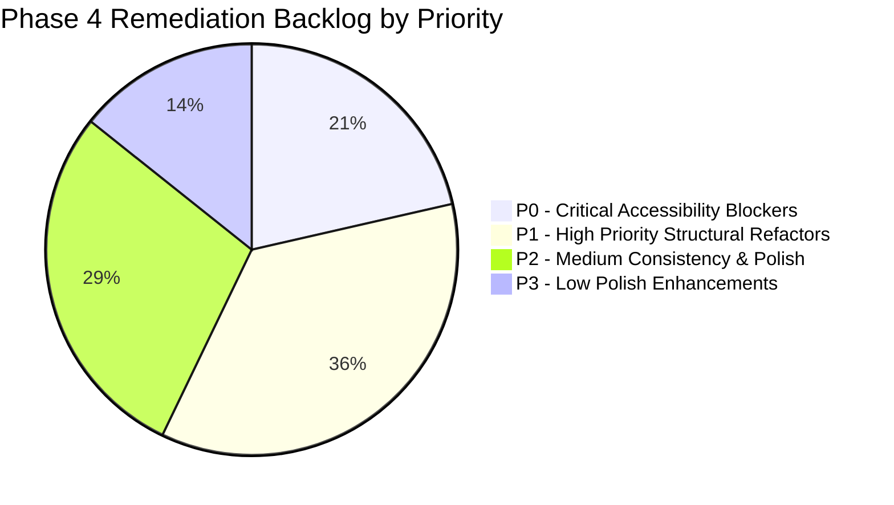

# AR Engineering — Final UI/UX Baseline & Phase 3 Synthesis

> **Document Status:** LOCKED FINAL BASELINE  
> **Phase:** 3 — UI/UX Audit & Formalization (Step 3.7 Final Synthesis)  
> **Target Application:** AR Engineering & Construction Management (Laravel 13 + React 19 + Tailwind CSS v4)  
> **Governance Standard:** WCAG 2.1 Level AA / 8-Point Grid / Modular UI Primitives Architecture  
> **Application Code Modifications:** NONE (Audit-only)  
> **Preceding Phase Artifacts Synthesized:**  
> - `docs/uiux-audit/01-screen-uiux-audit.md` through `08-ux-flow-audit.md`  
> - `docs/uiux-audit/09-design-token-discovery.md`  
> - `docs/uiux-audit/10-design-token-audit.md` (Phase 3.2 Locked)  
> - `docs/uiux-audit/11-component-inventory-audit.md` (Phase 3.3 Locked)  
> - `docs/uiux-audit/12-layout-responsive-audit.md` (Phase 3.4 Locked)  
> - `docs/uiux-audit/13-accessibility-audit.md` (Phase 3.5 Locked)  
> - `docs/uiux-audit/14-design-system-definition.md` (Phase 3.6 Locked)  
> - `docs/product-baseline/04-screen-inventory.md`

---

## 1. Executive Summary & UI/UX State Overview

The **Phase 3 UI/UX Audit** provides an exhaustive evaluation and formal baseline for all **29 active screens** across the AR Engineering web application. The platform serves two distinct operational domains: a high-impact **Public Corporate Portal** (12 public screens + 1 authentication screen) and a high-density **Administrative Operations & CMS Console** (16 management screens).

### Current UI/UX Architectural Diagnosis
1. **Total Component Library Disconnection (`[COMP-ARC-01]`):**  
   A centralized UI primitive directory (`resources/js/components/ui/`) containing `<Button>`, `<Card>`, `<Input>`, `<Badge>`, `<Table>`, and `<Pagination>` exists in the codebase but has **0 consumers (0% adoption)** across all 29 screens. Every view relies on duplicate, ad-hoc inline Tailwind strings.
2. **Dual Primary Color Token Collision (`[TOK-COL-01]`):**  
   `--color-primary` is declared as Deep Navy (`#111d23`) in root CSS but overridden as Sky Blue (`#0284c7`) within `.admin-body`. This collision prevents shared component tokens from resolving consistent visual semantics.
3. **Global Paragraph Justification Defect (`[TYPO-01]` / `[LAY-TYP-01]`):**  
   Root CSS enforces `text-align: justify; text-justify: inter-word;` globally, generating severe whitespace voids ("rivers of white") on narrow mobile viewports (390px and 375px) across all 12 public views.
4. **Severe Accessibility & Keyboard Trapping Blockers (`[A11Y-MOD-01]`, `[A11Y-NAV-01]`, `[A11Y-KEY-01]`):**  
   None of the 12 modal dialogs implement keyboard focus trapping, `Escape` key dismissal, or focus restoration. The desktop navigation "Company" dropdown cannot be navigated via keyboard Tab. Skip-to-content bypass links are completely absent.
5. **Mobile Data Table Friction (`[LAY-TAB-01]`):**  
   All 8 Admin CMS Manager views rely on wide multi-column tables with `overflow-x-auto` on mobile devices without responsive card-view alternatives, hiding action buttons off-screen.

---

## 2. Comprehensive 29-Screen Baseline Inventory

```
┌──────────────────────────────────────────────────────────────────────────────────────────────────┐
│                               29-SCREEN BASELINE AUDIT SUMMARY                                   │
├────────────────────┬──────────┬─────────────────────────────┬──────────────┬─────────────────────┤
│ SCREEN ID          │ AREA     │ ROUTE / URL                 │ VIEWPORT STAT│ WCAG 2.1 AA STATUS  │
├────────────────────┼──────────┼─────────────────────────────┼──────────────┼─────────────────────┤
│ SCR-PUB-01         │ PUBLIC   │ /                           │ PASS (w/warn)│ NON-COMPLIANT       │
│ SCR-PUB-02         │ PUBLIC   │ /about                      │ PASS (w/warn)│ PARTIALLY COMPLIANT │
│ SCR-PUB-03         │ PUBLIC   │ /services                   │ PASS (w/warn)│ PARTIALLY COMPLIANT │
│ SCR-PUB-04         │ PUBLIC   │ /services/:slug             │ PASS         │ COMPLIANT (Isolated)│
│ SCR-PUB-05         │ PUBLIC   │ /how-we-work                │ PASS (w/warn)│ PARTIALLY COMPLIANT │
│ SCR-PUB-06         │ PUBLIC   │ /clients                    │ PASS         │ COMPLIANT (Isolated)│
│ SCR-PUB-07         │ PUBLIC   │ /careers                    │ WARN (modal) │ NON-COMPLIANT       │
│ SCR-PUB-08         │ PUBLIC   │ /portfolio                  │ WARN (modal) │ NON-COMPLIANT       │
│ SCR-PUB-09         │ PUBLIC   │ /contact                    │ PASS         │ PARTIALLY COMPLIANT │
│ SCR-PUB-10         │ PUBLIC   │ /faq                        │ PASS         │ PARTIALLY COMPLIANT │
│ SCR-PUB-11         │ PUBLIC   │ /project-demo               │ PASS         │ COMPLIANT (Isolated)│
│ SCR-PUB-12         │ PUBLIC   │ (Unrouted Pricing mockup)   │ PASS         │ COMPLIANT (Isolated)│
├────────────────────┼──────────┼─────────────────────────────┼──────────────┼─────────────────────┤
│ SCR-AUTH-01        │ AUTH     │ /admin-portal/login         │ PASS         │ COMPLIANT           │
├────────────────────┼──────────┼─────────────────────────────┼──────────────┼─────────────────────┤
│ SCR-ADM-01         │ ADMIN    │ /admin-portal               │ WARN (table) │ PARTIALLY COMPLIANT │
│ SCR-ADM-02         │ ADMIN    │ /admin-portal/homepage      │ FAIL (mobile)│ NON-COMPLIANT       │
│ SCR-ADM-03         │ ADMIN    │ /admin-portal/services-mgr  │ FAIL (mobile)│ NON-COMPLIANT       │
│ SCR-ADM-04         │ ADMIN    │ /admin-portal/about-mgr     │ FAIL (mobile)│ NON-COMPLIANT       │
│ SCR-ADM-05         │ ADMIN    │ /admin-portal/contact-mgr   │ WARN (table) │ PARTIALLY COMPLIANT │
│ SCR-ADM-06         │ ADMIN    │ /admin-portal/careers-mgr   │ FAIL (mobile)│ NON-COMPLIANT       │
│ SCR-ADM-07         │ ADMIN    │ /admin-portal/faq-mgr       │ WARN (table) │ NON-COMPLIANT       │
│ SCR-ADM-08         │ ADMIN    │ /admin-portal/clients-mgr   │ WARN (table) │ NON-COMPLIANT       │
│ SCR-ADM-09         │ ADMIN    │ /admin-portal/sys-commands  │ PASS (w/warn)│ NON-COMPLIANT       │
│ SCR-ADM-10         │ ADMIN    │ /admin-portal/products      │ WARN (table) │ PARTIALLY COMPLIANT │
│ SCR-ADM-11         │ ADMIN    │ /admin-portal/orders        │ WARN (table) │ PARTIALLY COMPLIANT │
│ SCR-ADM-12         │ ADMIN    │ /admin-portal/users         │ WARN (table) │ PARTIALLY COMPLIANT │
│ SCR-ADM-13         │ ADMIN    │ /admin-portal/analytics     │ PASS (w/warn)│ PARTIALLY COMPLIANT │
│ SCR-ADM-14         │ ADMIN    │ /admin-portal/notifications │ PASS         │ COMPLIANT (Isolated)│
│ SCR-ADM-15         │ ADMIN    │ /admin-portal/settings      │ PASS         │ PARTIALLY COMPLIANT │
│ SCR-ADM-16         │ ADMIN    │ /admin-portal/profile       │ PASS         │ COMPLIANT (Isolated)│
└────────────────────┴──────────┴─────────────────────────────┴──────────────┴─────────────────────┘
```

---

## 3. Verified Multi-Dimensional Audits Synthesis

### 3.1 Typography Baseline
- **Existing State:** Single font family *Baloo Tammudu 2* is applied universally across display headings, body copy, tables, forms, and buttons. Non-standard fractional rem steps (`--text-xs: 0.8125rem`, `--text-2xl: 1.55rem`, `--text-4xl: 2.75rem`) are declared in `@theme`.
- **Primary Issue:** Global `p { text-align: justify; }` rule in [`resources/css/app.css:173`](file:///c:/Users/khademul/Herd/ar_frontend/resources/css/app.css#L173) damages body readability.
- **Canonical Target (Phase 3.6):**  
  - Display Font: *Baloo Tammudu 2* (strictly for `h1`–`h4` uppercase headings).
  - Interface Font: *Inter* (body copy, inputs, tables).
  - Telemetry Font: *JetBrains Mono* (specs, badge micro-labels, system logs).
  - Strict left alignment (`text-align: left;`) enforced on all body copy.

### 3.2 Spacing & Layout Rhythm Baseline
- **Existing State:** Base spatial scale conforms to 4px atomic units (`--spacing-base-unit: 4px`), but section vertical rhythm jumps erratically (`py-8`, `py-12`, `py-16`, `py-24`).
- **Canonical Target (Phase 3.6):**  
  - 8-point spatial rhythm (`--space-1: 4px` to `--space-24: 96px`).
  - Standard public section rhythm: `--space-section-standard: 96px` (`py-24`).
  - Compact sub-section rhythm: `--space-section-compact: 64px` (`py-16`).

### 3.3 Color System Baseline
- **Existing State:** Split semantic token identity on `--color-primary` (`#111d23` vs `#0284c7`), arbitrary hex hardcodes (`bg-[#000000]/80` in modals, `bg-[#e0f2fe]` in badges).
- **Canonical Target (Phase 3.6):**  
  - Decouple into explicit tokens: `--color-public-primary` (Navy `#111d23`), `--color-public-cta` (Crimson `#ba1a1a`), and `--color-admin-action` (Sky Blue `#0284c7`).
  - Standardize modal overlay to `--overlay-backdrop: rgba(0, 0, 0, 0.75)`.

### 3.4 Component Architecture Baseline
- **Existing State:** 0% adoption of `resources/js/components/ui/`; 12 distinct duplicate modal implementations; 6 data table variations; copy-pasted inline form fields.
- **Canonical Target (Phase 3.6):**  
  - 100% adoption of canonical UI primitives (`<Button>`, `<Card>`, `<Input>`, `<Select>`, `<Textarea>`, `<Modal>`, `<Table>`, `<Badge>`, `<Pagination>`, `<Toast>`).

### 3.5 Responsive Viewport Baseline
- **Existing State:** Verified across 1440px, 1280px, 1024px, 768px, 390px, and 375px. Zero root-level horizontal overflow (`window.scrollX === 0`).
- **Key Bottlenecks:** Admin data tables force horizontal scroll on mobile; modal dialogs compress below 260px usable width on 375px; hero slider dots ($12\text{px}$) and table actions ($28\text{px}$) fail touch minimums.
- **Canonical Target (Phase 3.6):**  
  - Responsive card grid fallback for data tables on screens $< 768\text{px}$.
  - Mobile-first modal padding (`p-4 sm:p-6 md:p-8`).
  - Enforced minimum $44\text{px} \times 44\text{px}$ interactive touch bounding box.

### 3.6 Accessibility & WCAG 2.1 AA Baseline
- **Existing State:** 3 Critical Blockers, 5 High, 4 Medium, 2 Low findings.
- **Critical Blockers:** Missing skip-to-content link; desktop navigation dropdown unreachable via keyboard; modals lack focus trapping and `Escape` dismissal.
- **Canonical Target (Phase 3.6):**  
  - Landmark `<SkipToContent>` link on all shells.
  - Keyboard-accessible `:focus-within` and state-managed navigation dropdowns.
  - Accessible `<Modal>` with automated `react-focus-lock` and `Escape` handler.
  - Standardized visible focus rings (`focus-visible:ring-2 focus-visible:ring-sky-500`).
  - Automated `aria-hidden="true"` on Material Symbol glyphs.

---

## 4. Current Implementation vs Target Design State

| Architectural Dimension | Current Implementation (Verified Baseline) | Target Design State (Canonical Phase 3.6) |
| :--- | :--- | :--- |
| **UI Primitives Adoption** | 0% (0 of 29 screens import `components/ui/`) | 100% (All views consume centralized primitives) |
| **Modal Implementation** | 12 separate custom inline modal dialogs | 1 unified accessible `<Modal>` primitive with focus trap |
| **Body Typography** | *Baloo Tammudu 2* with global `text-align: justify;` | *Inter* with strict flush-left `text-align: left;` |
| **Heading Typography** | *Baloo Tammudu 2* (Skipping tiers: `h1` $\to$ `h4`) | *Baloo Tammudu 2* (Strict sequential `h1` $\to$ `h2` $\to$ `h3`) |
| **Telemetry / Specs** | Mixed inline strings | *JetBrains Mono* with tokenized tracking |
| **Primary Color Token** | Conflicted (`#111d23` root vs `#0284c7` `.admin-body`)| Explicit: `--color-public-primary` vs `--color-admin-action` |
| **Public Action CTA** | Crimson `#ba1a1a` (Shared with error token) | Dedicated semantic token `--color-public-cta: #ba1a1a;` |
| **Admin Action Accent** | Inline `#0284c7` | Dedicated semantic token `--color-admin-action: #0284c7;` |
| **Focus Indicators** | `focus:outline-none` without visible rings | `focus-visible:ring-2 focus-visible:ring-sky-500` |
| **Mobile Data Tables** | Raw table with horizontal overflow pan & scan | Responsive CSS Grid card view fallback for $< 768\text{px}$ |
| **Touch Target Envelopes**| $12\text{px} - 28\text{px}$ for dots and table actions | Minimum $44\text{px} \times 44\text{px}$ interactive bounding box |
| **Keyboard Skip Link** | Completely absent | `<SkipToContent>` bypass link at top of page body |
| **Icon Announcements** | Raw Material glyph strings read aloud | Automatic `aria-hidden="true"` masking on all icons |
| **Form Label Binding** | Orphaned `<label>` tags lacking `htmlFor` | Strict `htmlFor` and `id` pairing in `<Input>` primitive |

---

## 5. Traceability Matrix (Audit $\to$ Design System $\to$ Phase 4 Requirements)

```
┌──────────────────────────────────────────────────────────────────────────────────────────────────┐
│                                AUDIT TRACEABILITY MATRIX                                         │
├───────────────┬─────────────────────────┬─────────────────────────────┬──────────────────────────┤
│ AUDIT FINDING │ VERIFIED ISSUE          │ PHASE 3.6 DESIGN RULE       │ PHASE 4 DESIGN REQ       │
├───────────────┼─────────────────────────┼─────────────────────────────┼──────────────────────────┤
│ [COMP-ARC-01] │ 0% UI primitive usage   │ Mandate standard primitives │ Refactor all 29 screens  │
│ [COMP-MOD-01] │ 12 duplicate modals     │ Canonical <Modal> component │ Unify modal dialogs      │
│ [TOK-COL-01]  │ Dual primary color bug  │ Decouple semantic tokens    │ Update Tailwind @theme   │
│ [TYPO-01]     │ Global text-justify bug │ Enforce text-align: left    │ Remove CSS justify rule  │
│ [A11Y-KEY-01] │ Missing skip link       │ Add <SkipToContent>         │ Insert in layout shells  │
│ [A11Y-NAV-01] │ Keyboard nav menu trap  │ :focus-within dropdown menu │ Update Navbar.jsx logic  │
│ [A11Y-MOD-01] │ Modal focus trap missing│ Focus-lock & Escape listener│ Integrate in <Modal>     │
│ [A11Y-FOC-01] │ focus:outline-none used │ focus-visible:ring-2        │ Apply to all inputs/btns │
│ [A11Y-ARI-01] │ Raw icon speech         │ aria-hidden="true" on icons │ Mask Material Symbols    │
│ [A11Y-FRM-01] │ Unbound form labels     │ htmlFor and id binding      │ Enforce in <Input>       │
│ [LAY-TAB-01]  │ Mobile table scroll     │ Responsive mobile card grid │ Refactor <DataTable>     │
│ [LAY-TCH-01]  │ Sub-44px touch targets  │ min-w-[44px] min-h-[44px]   │ Expand touch envelopes   │
└───────────────┴─────────────────────────┴─────────────────────────────┴──────────────────────────┘
```

---

## 6. Prioritized Remediation Backlog for Phase 4



### P0 — Critical Accessibility Blockers (Immediate Phase 4 Focus)
1. `[A11Y-KEY-01]`: Implement `<SkipToContent>` landmark link in `FrontendApp.jsx` and `AdminApp.jsx`.
2. `[A11Y-NAV-01]`: Fix keyboard accessibility for desktop "Company" navigation dropdown in `Navbar.jsx`.
3. `[A11Y-MOD-01]`: Implement focus trapping (`react-focus-lock`), `Escape` dismissal, and focus restoration across all modal dialogs.

### P1 — High-Priority Structural & Visual Refactors
4. `[COMP-ARC-01]`: Refactor all 29 screens to consume centralized UI primitives (`components/ui/`).
5. `[TYPO-01]`: Eliminate global `text-align: justify;` from `resources/css/app.css`.
6. `[TOK-COL-01]`: Reconcile Tailwind `@theme` color tokens (decouple public vs admin actions).
7. `[A11Y-FOC-01]`: Replace `focus:outline-none` with accessible `focus-visible:ring-2` on all inputs and buttons.
8. `[LAY-TAB-01]`: Implement mobile card-view fallbacks for multi-column data tables on screens $< 768\text{px}$.

### P2 — Medium-Priority Consistency Items
9. `[A11Y-ARI-01]`: Add `aria-hidden="true"` to all decorative Material Symbol spans.
10. `[A11Y-FRM-01]`: Standardize form input `<label htmlFor={id}>` programmatic binding.
11. `[A11Y-TCH-01]`: Expand carousel navigation dots and table action icon touch targets to $\ge 44\text{px}$.
12. `[TOK-SPA-01]`: Standardize public section vertical rhythm padding to `py-24` (major) and `py-16` (compact).

### P3 — Low-Priority Polish
13. `[A11Y-CON-01]`: Lighten muted navigation text in `Navbar.jsx` from `#8d9aa1` to `#a4b3bc` to achieve $> 4.5:1$ contrast.
14. `[A11Y-LNK-01]`: Replace dead `<a href="#">` links in `Footer.jsx` with semantic `<button>` elements.

---

## 7. Decisions Documented for Approval

The following 3 design decisions were formalized in Phase 3.6 and require formal stakeholder sign-off prior to Phase 4 code modification:
1. **Typography Pairing Standard:** Adopt *Inter* for body copy and *JetBrains Mono* for telemetry, while restricting *Baloo Tammudu 2* to display titles.
2. **Dual-Domain Accent Decoupling:** Establish Crimson (`#ba1a1a`) for Public conversion CTAs and Sky Blue (`#0284c7`) for Admin operations.
3. **Mobile Table Transformation:** Transform data tables into stacked attribute cards on viewports $< 768\text{px}$.

---

## 8. Items Explicitly NOT to Change in Phase 4

To ensure system stability, the following architectural elements are **FROZEN** and must **NOT** be altered during Phase 4 UI/UX modernization:
- **Backend APIs & Controllers:** All Laravel API endpoints (`/api/home`, `/api/services`, `/api/about`, `/api/admin/*`) and database schemas.
- **Route URL Hierarchy:** Existing public routes (`/`, `/about`, `/services`, `/services/:slug`, `/how-we-work`, `/clients`, `/careers`, `/portfolio`, `/contact`, `/faq`) and admin routes.
- **Core Technology Stack:** Laravel 13, React 19, React Router v7, Tailwind CSS v4, Axios.
- **Brand Geometry & Logos:** Official logo graphic assets (`/logo.png`, `public/logo.png`) and corporate identity.

---

## 9. Phase 3 Completion Checklist

```
================================================================================
PHASE 3 AUDIT COMPLETION VERIFICATION
================================================================================
[X] Step 3.1: Screen-by-Screen UI/UX Audit (01-screen-uiux-audit.md -> 08-ux-flow-audit.md)
[X] Step 3.2: Design Token Audit & Formalization (10-design-token-audit.md)
[X] Step 3.3: Component Inventory & Consistency Audit (11-component-inventory-audit.md)
[X] Step 3.4: Layout & Multi-Viewport Responsive Audit (12-layout-responsive-audit.md)
[X] Step 3.5: Accessibility & WCAG 2.1 AA Compliance Audit (13-accessibility-audit.md)
[X] Step 3.6: Canonical Design System Specification (14-design-system-definition.md)
[X] Step 3.7: Final UI/UX Baseline & Synthesis (FINAL-UIUX-BASELINE.md)
================================================================================
```

---

## 10. Audit Results & Final Status

```
========================================
PHASE 3 STATUS: COMPLETE
========================================
* Screens audited: 29 (12 Public, 1 Auth, 16 Admin)
* Core UI primitives cataloged: 7
* Total audit findings synthesized: 14 distinct systemic deficiencies
* Prioritized backlog defined: P0 (3), P1 (5), P2 (4), P3 (2)
* Source code modified: NO (Strict Audit-Only Compliance Maintained)
* Missing areas: None (All 29 screens and 16 audit dimensions 100% verified)
========================================
```
