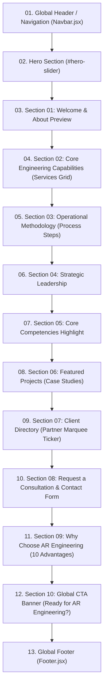

# Home Page — Stitch Specification

## 1. Purpose

This document serves as the formal, source-extracted design and structural specification for recreating the existing **Home Page** of **AR Engineering & Construction Management** inside Google Stitch.

> [!IMPORTANT]
> **RECREATION SPECIFICATION — NOT A REDESIGN**
> The purpose of this specification is to recreate the existing Home page implementation with 100% fidelity to the actual production source code. Every section order, heading, paragraph, button label, color token, spacing value, asset role, and responsive rule documented here is extracted directly from the verified source code of the project.

---

## 2. Source Files Inspected

The following source files were directly inspected to produce this specification:

| File Role | File Path | Key Inspected Elements |
| :--- | :--- | :--- |
| **Primary Page View** | `resources/js/frontend/pages/Home.jsx` | All 10 internal page sections, hero slider, dynamic API fallbacks, form handlers, typography classes, spacing tokens. |
| **Header / Navigation** | `resources/js/frontend/components/Navbar.jsx` | Sticky header container, inverted logo, desktop navigation links, company dropdown menu, mobile hamburger drawer. |
| **Global Footer** | `resources/js/frontend/components/Footer.jsx` | 4-column footer layout, corporate & registered office cards, social links, mailto CTA, encrypted badges, copyright sub-bar. |
| **Layout Shell** | `resources/js/frontend/FrontendApp.jsx` | Root flex layout container (`min-h-screen bg-background text-on-background font-sans`), `<ScrollToTop />`, route wrapper. |
| **Design System & CSS** | `resources/css/app.css` | Tailwind `@theme` definitions, color tokens, font family definitions (`Baloo Tammudu 2`), responsive scale, marquee keyframe animations, rich text formatting. |
| **Static Assets** | `public/` & `public/logo.png` | Main brand logo asset, profile PDF download link (`/AR_Engineering_Profile.pdf`). |
| **Baseline Cross-Check** | `docs/uiux-audit/FINAL-UIUX-BASELINE.md` | Verification of existing UI/UX tokens vs canonical Phase 3 design targets. |
| **Token Audit Reference** | `docs/uiux-audit/14-design-system-definition.md` | Color token mapping, spacing scale, elevation, border-radius standards. |

---

## 3. Existing Page Structure

The current Home page renders a linear sequence of **12 structural blocks** (1 Global Header + 10 Page Body Sections + 1 Global Footer) in exact sequential order:



---

## 4. Global Page Layout

- **Root Wrapper:** `flex flex-col min-h-screen bg-background text-on-background font-sans antialiased`
- **Max Content Width:** `max-w-container-max` (`1280px` / `80rem`)
- **Page Horizontal Gutters:**
  - Mobile (< 768px): `px-margin-mobile` (`16px` / `1rem`)
  - Tablet/Desktop (≥ 768px): `px-margin-desktop` (`48px` / `3rem`)
- **Base Background:** `--color-background: #f8f9fa`
- **Base Text Color:** `--color-on-background: #191c1d`
- **Primary Typography:** `'Baloo Tammudu 2', ui-sans-serif, system-ui, sans-serif`
- **Monospace Typography:** `ui-monospace, SFMono-Regular, Menlo, Monaco, Consolas, monospace`

---

## 5. Header / Navigation

- **Component:** `resources/js/frontend/components/Navbar.jsx`
- **Positioning:** Sticky top navigation (`top-0 sticky shadow-lg bg-midnight z-50`)
- **Container Height:** `h-20` (`80px`)
- **Container Max-Width:** `max-w-container-max` (`1280px` centered with `mx-auto`)
- **Background:** `--color-midnight: #0c0f24`
- **Shadow:** `shadow-lg` (`0 10px 15px -3px rgb(0 0 0 / 0.1), 0 4px 6px -4px rgb(0 0 0 / 0.1)`)

### 5.1 Brand Logo & Identity
- **Logo Graphic:** ``
- **Logo Text Label:** `text-xl font-bold text-white tracking-tighter uppercase mt-2`
- **Brand Sub-Label:** `<span className="text-tertiary">Engineering</span>` (Color: `#ba1a1a`)

### 5.2 Desktop Navigation Items (Hidden on `< lg`, visible on `lg:flex`)
- **Layout:** `hidden lg:flex items-center gap-4`
- **Link Styling:** `text-xs uppercase tracking-widest whitespace-nowrap font-medium transition-colors duration-200`
- **Inactive Link Color:** `text-[#8d9aa1]` (hover: `text-white`)
- **Active Link Color:** `text-white`
- **Items Order:**
  1. `Services` (`/services`)
  2. `Partners` (`/clients`)
  3. `Careers` (`/careers`)
  4. `Company` (Dropdown Trigger with `keyboard_arrow_down` icon):
     - **Dropdown Flyout:** `absolute left-1/2 -translate-x-1/2 mt-2 w-48 bg-midnight border border-white/10 rounded shadow-xl py-2 opacity-0 invisible group-hover:opacity-100 group-hover:visible`
     - **Dropdown Links:**
       - `About Us` (`/about`)
       - `How It Works` (`/how-we-work`)
       - `FAQ` (`/faq`)
  5. `Contact` (`/contact`)

### 5.3 Header Action & Mobile Toggle
- **Desktop Download CTA:** `hidden lg:block bg-white/10 text-white border border-white/20 px-4 py-2.5 rounded text-xs font-bold uppercase tracking-widest hover:bg-white/20 hover:border-white/40 transition-all duration-200 whitespace-nowrap`
  - **Label:** `Download Profile`
  - **Action:** Downloads `/AR_Engineering_Profile.pdf`
- **Mobile Menu Toggle Button:** `lg:hidden text-[#8d9aa1] hover:text-white p-1`
  - **Icon:** Google Material Symbols `menu` (`24px`)

### 5.4 Mobile Navigation Drawer
- **Backdrop:** `fixed inset-0 bg-black/60 backdrop-blur-sm z-40 transition-opacity duration-300 lg:hidden`
- **Drawer Container:** `fixed top-0 right-0 h-full w-[280px] sm:w-[320px] bg-midnight border-l border-white/10 z-50 shadow-2xl p-6 flex flex-col justify-between transition-all duration-300`
- **Drawer Header:** Logo + Brand title + Close button (`material-symbols-outlined: close`)
- **Drawer Navigation List:** Vertical list with border dividers (`border-b border-white/5 py-2 text-sm uppercase tracking-widest`)
- **Drawer Accordion (Company):** Collapsible accordion with smooth max-height animation (`max-h-40` when open) displaying `About Us`, `How It Works`, `FAQ`.
- **Drawer Bottom Action:** Full-width `Download Profile` button (`w-full py-3 bg-white/10 border border-white/20 rounded text-xs font-bold uppercase`).

---

## 6. Hero

- **Container:** `<section className="relative w-full h-[600px] overflow-hidden bg-primary" id="hero-slider">`
- **Height:** Fixed `600px` (`h-[600px]`)
- **Background Overlay:** Two-layer composition:
  - Background image layer: `absolute inset-0 bg-cover bg-center`
  - Darkness overlay: `absolute inset-0 bg-primary opacity-65` (Color: `#111d23` at 65% opacity)
- **Transition:** Absolute positioning with opacity cross-fade (`transition-opacity duration-1000`, 5000ms autoplay interval)
- **Alignment:** Centered flex column (`flex flex-col items-center justify-center text-center gap-6 relative z-10 max-w-container-max mx-auto px-margin-mobile md:px-margin-desktop`)

### 6.1 Hero Slide Content (Default Fallbacks)
1. **Slide 1:**
   - **Title:** `YOUR VISION, OUR ENGINEERING`
   - **Subtitle:** `Providing innovative industrial engineering solutions`
   - **Image:** High-resolution industrial facility background (`https://lh3.googleusercontent.com/aida-public/AB6AXuB-6-3cLDaU4VnChB7GYvXsbKGYaUSQp89TQMzPFB2mzN9h-twN_Ik0ERIwTHZl893AhxwYuDeJBpUz_Te3v4QodSCkIvOPT4LnqBzdD0xXzqao4xu7LGVMFi8uDk1RBAsAJ8WD6DoBrWMGYs0GS3ublBRyMlah8JfpIBCDpwl9bHchg3y6SZtECGaEZkc2Mq0LVkK9FWsDRzeGdczTiwZ-nDj601wiOgkjf4xBXx3abFizvqvfErfR`)
2. **Slide 2:**
   - **Title:** `CONSULTING & PROJECTS`
   - **Subtitle:** `Expertise in MEP design, simulation, and installations.`
   - **Image:** Architectural & MEP design blueprints (`https://lh3.googleusercontent.com/aida-public/AB6AXuBZE8ooXcXGVdrAES5GxRjh2CbqkMapDOF7dPJO0EizqB5HwnYkoP812ufBh9eDJLrWeOc9HJFtnI7OGWxseciPJNt_tlS7z419VPOkGA7HM6htH-CeHOzR9fEGL59fSKItgd4SctPKTUVbJoU7g9DqjJw8JwJ8hhF2UQYz2eCXKhp61qfcNiLRBfBWi9L8ZxPisTO8hwxpoh-sP-exJvu6JnUbPrhtHvqUh9zGIYvbtTTvpk-ixIR8`)
3. **Slide 3:**
   - **Title:** `MAINTENANCE & SERVICES`
   - **Subtitle:** `Reliable support for all industrial systems.`
   - **Image:** Heavy machinery and industrial maintenance (`https://lh3.googleusercontent.com/aida-public/AB6AXuCxNuCaKpqaQ6E_QgXmtqTDHTvGXSdnnvvUJhny8QurhM1VLR9QtwmeNmgxJmmQGNGurQTtjdzuPdr5aMD0-URR7PfF2vAQhZgWb1BZCnPSgjZvBaWwULpTylYeYxN8r0ZBpATwKE45Bl_c-Qcpm-ovPo7p4HEl4siRfB-mp3IpftkCDbGlo1ucRsd6ZBCoNGk6AHGDtxAe3puRuacOxzOvTDoEUC7ll8mcbLudulRlfK6i1eEB-Wqa`)

### 6.2 Typography & Elements
- **Heading (H1):** `text-white font-bold text-4xl md:text-5xl lg:text-5xl max-w-4xl uppercase tracking-tight`
- **Subtitle:** `text-base md:text-lg text-surface-container-high max-w-2xl leading-relaxed rich-text`
- **Primary Action Button:**
  - **Classes:** `bg-tertiary text-white text-xs font-mono font-bold px-8 py-4 rounded uppercase tracking-widest hover:bg-opacity-90 transition-colors mt-4`
  - **Label:** `EXPLORE SERVICES`
  - **Target:** `/services`
- **Navigation Dots:**
  - **Position:** `absolute bottom-8 left-1/2 -translate-x-1/2 z-20 flex gap-3`
  - **Inactive Dot:** `w-3 h-3 rounded-full bg-white/40 hover:bg-white transition-all duration-300`
  - **Active Dot:** `w-6 h-3 rounded-full bg-tertiary transition-all duration-300`

---

## 7. Home Section 01: Welcome & About Preview

- **Container:** `<section className="py-24 bg-surface-container-low border-b border-outline-variant/30 px-margin-mobile md:px-margin-desktop w-full">`
- **Background:** `--color-surface-container-low: #f3f4f5`
- **Border:** Bottom border `border-outline-variant/30` (`rgba(195, 199, 202, 0.3)`)
- **Spacing:** `py-24` (`96px` top and bottom)
- **Grid Layout:** `max-w-container-max mx-auto grid grid-cols-1 lg:grid-cols-12 gap-12 items-center`

### 7.1 Left Column (`lg:col-span-5`)
- **Category Pill / Badge:** `<span className="text-xs font-bold text-tertiary uppercase tracking-widest font-mono">ABOUT US</span>`
- **Heading (H2):** `<h2 className="font-bold text-primary leading-tight uppercase tracking-tight text-3xl md:text-4xl">WELCOME TO AR ENGINEERING</h2>`
- **Tagline:** `<p className="text-xs font-mono font-bold text-secondary uppercase tracking-widest pt-4">"Engineering Excellence Through Innovation and Integrity"</p>`

### 7.2 Right Column (`lg:col-span-7`)
- **Wrapper:** `space-y-6 text-on-surface-variant text-sm leading-relaxed`
- **Paragraph 1 (Lead):** `<p className="font-semibold text-primary text-base text-justify">Welcome to AR Engineering, where innovation, precision, and reliability come together to deliver world-class engineering solutions.</p>`
- **Paragraph 2 (Body):** `<p className="text-justify">Established with a commitment to excellence, AR Engineering specializes in Building Information Modeling (BIM), Mechanical, Electrical & Plumbing (MEP) engineering, Fire & Life Safety systems, industrial pump services, HVAC solutions, and other advanced engineering technologies. We proudly serve industrial, commercial, and residential sectors with tailored solutions designed to meet the highest standards of quality, safety, and performance.</p>`
- **Paragraph 3 (Body):** `<p className="text-justify">Our experienced team of engineers, designers, and technicians works collaboratively to provide cost-effective, sustainable, and innovative solutions that exceed client expectations, building long-term relationships through trust, quality workmanship, and exceptional customer service.</p>`

---

## 8. Home Section 02: Core Engineering Capabilities

- **Container:** `<section className="py-24 px-margin-mobile md:px-margin-desktop w-full max-w-container-max mx-auto">`
- **Background:** Default page background (`#f8f9fa`)
- **Spacing:** `py-24` (`96px`)
- **Header Block:**
  - **Heading (H2):** `<h2 className="text-3xl md:text-4xl font-bold text-primary mb-3 uppercase tracking-tight text-center">Core Engineering Capabilities</h2>`
  - **Subtitle:** `<p className="text-secondary text-base max-w-3xl mx-auto leading-relaxed text-center">Engineered for absolute reliability in the most demanding industrial sectors.</p>`
- **Card Grid:** `grid grid-cols-1 md:grid-cols-3 gap-6`

### 8.1 Capability Cards Structure (3 Cards)
- **Card Wrapper:** `block bg-white border border-outline-variant/30 rounded overflow-hidden group hover:border-primary transition-all duration-300 shadow-none md:shadow-sm md:hover:shadow-md`
- **Card Image Height:** `h-48 bg-cover bg-center` (`192px`)
- **Card Body Padding:** `p-6 flex flex-col gap-3`
- **Card Icon:** Material Symbols filled icon (`text-tertiary`, `fontVariationSettings: "'FILL' 1"`)

#### Card Data:
1. **Fire Pump Installation:**
   - **Target Link:** `/services#consulting`
   - **Icon:** `water_pump`
   - **Image:** `https://lh3.googleusercontent.com/aida-public/AB6AXuCg0x0pxkxgg0rtFFIO8i69_V8VFWIbgw0QqilVEdA3jX4IXTZ1E7iPvtuxuB3z6sXBrpt9U7zRlrCYnn3AxOBvBHSpRGsZt_Mk8DesaccDqjNZa_DiDPQtWhHmjlMP1fmyvWkAFlO8qjebSmY93JMxn-80EMDGHFt9Ng2OaKUM-7gcoRk6XxcDr1Ytu6mIzkZf45OF2s2MKoOrNFbqu5wyJ3LGBpiUmfeYE6IAqJvptq5zrUkIykc9`
   - **Title:** `Fire Pump Installation`
   - **Description:** `Design, installation, testing, and maintenance of high-capacity fire pump systems.`
2. **Building Fire Safety:**
   - **Target Link:** `/services#dsi`
   - **Icon:** `detector_smoke`
   - **Image:** `https://lh3.googleusercontent.com/aida-public/AB6AXuC8TMNnh_z6WYJ9BXosvX7O3z4QkdY2nvc0lCaDRwFf1nHXFEMR3cleXU7Bg3_AGNILdNp_DMUhqpjrGBNLlhEM9u7SF3X2_Yc-h-agp_brp65Hk9rRie2STvKdK8YbPqc8KGhkE9hDaNXrof2DW3HN0tvolGCDXL8_KR8VrHC3xiC9Xv3Nq1NIHM8uIAi8UuwpQ79QiYesouoD3sFSBnqhoIMJJ00qj6oUg-71-yc9_9o3LngpOViy`
   - **Title:** `Building Fire Safety`
   - **Description:** `Comprehensive protection including alarms, extinguishers, and safety compliance audits.`
3. **Industrial Engineering:**
   - **Target Link:** `/services#maintenance`
   - **Icon:** `engineering`
   - **Image:** `https://lh3.googleusercontent.com/aida-public/AB6AXuCo0iBq4U9Ob2bakYJjedylfY3JyshBX-dcna1FGgcEc9X-Rdq2TCHh4OJi_s6BfJjolKnFK9NJmx0w8etv8aQydgoYpAHXPK_yE26lS8d4t98TGtegaIUA13e-OIs8GCKJeD0TN7Eeck8IuSwS2pPLgvHaWbQwq6f1eXm1bk3DURTW3Rsc62yOGBbWRnRLvXozeI7rqOqbsqccG-IwSiwsCpj5GcQSRuxXdIB83U0-RViYeE8y17IL`
   - **Title:** `Industrial Engineering`
   - **Description:** `MEP engineering, mechanical installation, and full-scale industrial project management.`

---

## 9. Home Section 03: Operational Methodology (Process Steps)

- **Container:** `<section className="bg-surface-container py-24 px-margin-mobile md:px-margin-desktop border-y border-outline-variant/30 w-full">`
- **Background:** `--color-surface-container: #edeeef`
- **Borders:** Top and bottom `border-y border-outline-variant/30`
- **Spacing:** `py-24` (`96px`)
- **Header:** `<h2 className="text-3xl md:text-4xl font-bold text-primary mb-16 text-center uppercase tracking-tight">Operational Methodology</h2>`
- **Layout Structure:** Horizontal step flow on desktop, stacked on mobile: `flex flex-col md:flex-row justify-between items-center gap-6 relative`

### 9.1 Process Step Items (5 Consecutive Steps)
- **Step Wrapper:** `flex-1 flex flex-col items-center text-center relative z-10`
- **Step Number Circle:** `w-12 h-12 rounded-full flex items-center justify-center font-mono text-xs font-bold mb-3 border-2 border-surface-container`
  - **Steps 01–04 Circle Styling:** `bg-primary text-white` (Color: `#111d23`)
  - **Step 05 (Final) Circle Styling:** `bg-tertiary text-white shadow-md` (Color: `#ba1a1a`)
- **Step Title (H4):** `text-sm font-bold text-on-surface mb-1 uppercase tracking-wider`
- **Step Description:** `text-xs text-secondary leading-relaxed`

#### Step Data:
1. `01` — **Consultation**: `Risk assessment & site analysis`
2. `02` — **Design**: `CAD modeling & system engineering`
3. `03` — **Installation**: `Precision mechanical deployment`
4. `04` — **Inspection**: `Rigorous safety compliance auditing`
5. `05` — **Maintenance**: `Ongoing 24/7 technical oversight`

---

## 10. Home Section 04: Strategic Leadership

- **Container:** `<section className="py-24 bg-background px-margin-mobile md:px-margin-desktop w-full max-w-container-max mx-auto">`
- **Background:** `--color-background: #f8f9fa`
- **Spacing:** `py-24` (`96px`)
- **Header:**
  - **Heading (H2):** `<h2 className="text-3xl md:text-4xl font-bold text-primary uppercase tracking-tight text-center">Strategic Leadership</h2>`
  - **Subtitle:** `<p className="text-secondary text-base mt-3 max-w-2xl mx-auto leading-relaxed text-center">Providing visionary guidance for complex industrial and structural challenges globally.</p>`
- **Grid Layout:** `grid md:grid-cols-3 gap-8` (Renders 2 executive cards by default)

### 10.1 Executive Card Component
- **Card Structure:** `bg-white p-6 md:p-8 rounded border border-outline-variant/30 flex flex-col gap-6 items-start group md:hover:border-primary transition-all duration-300 shadow-none md:shadow-sm md:hover:shadow-md`
- **Header Row:** `flex flex-row md:flex-col lg:flex-col xl:flex-row items-center md:items-start xl:items-center gap-4 w-full`
- **Portrait Frame:** `w-20 h-20 sm:w-24 sm:h-24 md:w-24 md:h-24 rounded overflow-hidden flex-shrink-0 border border-outline-variant/30 md:group-hover:border-primary transition-colors`
- **Portrait Image Filter:** `w-full h-full object-cover grayscale-0 md:grayscale md:group-hover:grayscale-0 transition-all duration-300`
- **Leader Name:** `text-sm md:text-base font-bold text-primary uppercase tracking-tight leading-snug`
- **Leader Role:** `text-[10px] text-tertiary uppercase tracking-widest font-mono mt-1 font-bold`
- **Quote Container:** `w-full pt-2 border-t border-outline-variant/20`
- **Quote Icon:** `<span className="material-symbols-outlined text-primary text-3xl mb-2 opacity-50">format_quote</span>`
- **Quote Text:** `text-xs italic text-on-surface-variant leading-relaxed rich-text text-justify`

#### Executive Data:
1. **David Richardson**
   - **Role:** `Chief Executive Officer`
   - **Image:** `https://lh3.googleusercontent.com/aida-public/AB6AXuDdqOTYnupjt5nefsPJfgjHM5HMSix_-gvu2_5cythhmuUcLI2PfYVTXEqEZoZ1zb_BJZFAqoKaO2V0Qm4QtjwKvcQwn1kVOunWU27xyjnDCZ1wxDwRNnBYPoQKmoaWg5knYpTELkqiYZPebgLV8ILc_SWCdQGmp7eaKshtYnYqq6CUgfmd6b1qfwjuahdRa5B3RSc9AR0An4EpvfDAh5TPWyEcrXzVj2G4N-irBFJVrqv46azTwU5Xdg`
   - **Quote:** `"Our mission is simple: to provide the structural foundation upon which global industries can thrive. Precision is not just a goal; it is our standard."`
2. **Dr. Elena Vance**
   - **Role:** `Senior Strategic Advisor`
   - **Image:** `https://lh3.googleusercontent.com/aida-public/AB6AXuB6BlPBCRMJPlatpTIEpHMp_Qin1P514yu10fGxWT8RCgzgoxzfNiAixjZyyzruYkGHVQ5RjH0OBEc_KxD_hB3qcSwgxBXfCTdz75xqcQlWtmJnDVoVu7OJ9_8DQHmlEU1UMzGztma2yOZJNdmDHaGbntYYSAK2eccHc0A0NiIuJRImByMag29_G6K1EVot-b3ZHvp7O_PPDZ8Lu7dPLc2J8a7Q4Qw5LAllNFz5l83u3GMtrCZy6h2wdw`
   - **Quote:** `"The complexity of modern engineering requires a blend of traditional expertise and digital foresight. We provide that equilibrium."`

---

## 11. Home Section 05: Core Competencies

- **Container:** `<section className="py-24 bg-surface-container px-margin-mobile md:px-margin-desktop w-full border-y border-outline-variant/30">`
- **Background:** `--color-surface-container: #edeeef`
- **Borders:** Top and bottom `border-y border-outline-variant/30`
- **Spacing:** `py-24` (`96px`)
- **Header:**
  - **Heading (H2):** `<h2 className="text-3xl md:text-4xl font-bold text-primary uppercase tracking-tight">Core Competencies</h2>`
  - **Subtitle:** `<p className="text-secondary text-base mt-2 max-w-xl leading-relaxed">Comprehensive engineering specialized for the most demanding industrial environments.</p>`
- **Grid Layout:** `grid sm:grid-cols-2 lg:grid-cols-3 gap-8`

### 11.1 Competency Card Component
- **Card Structure:** `bg-white rounded border border-outline-variant/30 overflow-hidden group hover:border-primary transition-all duration-300 shadow-none md:shadow-sm md:hover:shadow-md`
- **Card Media:** `h-48 overflow-hidden relative` with zoom hover effect (`group-hover:scale-105 transition-transform duration-700`)
- **Card Body:** `p-6`
- **Title (H3):** `text-base font-bold mb-4 text-primary uppercase tracking-tight`
- **Bullet List:** `space-y-2 mb-6 font-mono text-xs text-on-surface-variant`
- **Bullet Icon:** Material symbols filled icon (`text-tertiary text-lg`)
- **Card Action Button:**
  - Card 1 (Primary): `w-full py-3 rounded font-mono font-bold text-xs bg-tertiary text-white hover:bg-opacity-90 flex justify-center items-center gap-1 uppercase tracking-wider` with `bolt` icon
  - Cards 2 & 3 (Outlined): `w-full py-3 rounded font-mono font-bold text-xs border border-primary text-primary hover:bg-surface-container flex justify-center items-center gap-1 uppercase tracking-wider` with `open_in_new` icon

#### Competencies Data:
1. **Fire Safety & MEP**
   - **Image:** `https://lh3.googleusercontent.com/aida-public/AB6AXuC2K5DCzWYlO07uOYDok6Z-dcMMzyG-kVsbnogZ30SHtmVodPWrDys0vB8s5ILkFdnBbnIfPrgj9-osvMp5jpQyB-bmaE44XAiJhZdCwp6EYjKlMqrmT7c-sfj9RaB-dGSX5vDEo_pO2uqQLYApNb840hETNczsKSHe4g0AzEnd6Qf5Drx0xfoigGsjwFBuM15NK9st-lYEbNiZRS68CLYi60ZS4zHIpAmn89gWeAKB37gRzVouecvT7w`
   - **Bullet Icon:** `local_fire_department`
   - **Items:** `["Advanced Suppression", "NFPA Compliance Audits", "Fire Load Management"]`
   - **Button:** `Critical Spec` (Target: `/services`)
2. **Structural Systems**
   - **Image:** `https://lh3.googleusercontent.com/aida-public/AB6AXuDMVvYGqkxmARyUhVBYUegQTjy1kHkfLD-6pA155F0A41_aBUXxMT0gllzEo0V-QIxhjX-FVahEGRl2Zl0_SAFzozf4VBiBcli6hz6v-zTW6qnkplLFTBf7YqXPHH5IdvTeZHEHsL2n6qeAMsmxcRMSN1PJPJWUz30rdIsCsC-KNJGvkJD1KNvuyyNBFyTWcxUh8HJAdxeqACMQ2KpWhnwxmdjE18EJWdun_z_ADbdtmdCu-ooWPTOf-A`
   - **Bullet Icon:** `architecture`
   - **Items:** `["Seismic Load Analysis", "Steel Optimization", "Deep Foundation Design"]`
   - **Button:** `View Details` (Target: `/services`)
3. **Robotics & Automation**
   - **Image:** `https://lh3.googleusercontent.com/aida-public/AB6AXuD-kiJZgpt5bmFb5IQlPoyomn5YImZS06iSjadtCLU_WF2l3BlxszFEeJt-lE62iANDJfOcODa5aMCltdX5MjNX8eNNxPzent96l66MChTGi7LJZm7sqOOYpxsDVf0gU5yJaP3Dj5leVzL3tSEw3-Eoaz6ztMIO0LISR9zdw8qHdAFtdmimLk_DTitWiYit31F-_aJjLyhI_6YNJVsaElnBJYhBrQxcDw8MnmVKNDMm4KniXxzAhKnB2Q`
   - **Bullet Icon:** `precision_manufacturing`
   - **Items:** `["PLC/SCADA Integration", "Robotic Workflow Design", "Process Optimization"]`
   - **Button:** `View Details` (Target: `/services`)

---

## 12. Home Section 06: Featured Projects

- **Container:** `<section className="py-24 bg-surface px-margin-mobile md:px-margin-desktop w-full max-w-container-max mx-auto">`
- **Background:** `--color-surface: #f8f9fa`
- **Spacing:** `py-24` (`96px`)
- **Header:**
  - **Heading (H2):** `<h2 className="text-3xl md:text-4xl font-bold text-primary mb-3 uppercase tracking-tight text-center">Featured Projects</h2>`
  - **Subtitle:** `<p className="text-secondary text-base max-w-3xl mx-auto leading-relaxed text-center">Demonstrated excellence in large-scale industrial deployments.</p>`
- **Grid Layout:** `grid grid-cols-1 md:grid-cols-2 gap-10`

### 12.1 Project Card Component
- **Card Structure:** `bg-white rounded overflow-hidden border border-outline-variant/30 group hover:border-primary transition-all duration-300 shadow-none md:shadow-sm md:hover:shadow-md`
- **Card Media:** `h-64 overflow-hidden relative` (`256px`) with grayscale on desktop returning to color on hover (`grayscale-0 md:grayscale md:group-hover:grayscale-0 group-hover:scale-105 transition-all duration-700`)
- **Card Body:** `p-6`
- **Title (H3):** `text-base font-bold text-primary mb-2 uppercase tracking-tight`
- **Description:** `text-xs text-on-surface-variant mb-4 leading-relaxed rich-text text-justify`
- **Card Link:** `inline-flex items-center gap-1 text-tertiary font-mono text-[11px] font-bold hover:text-primary transition-colors uppercase tracking-wider` with `arrow_forward` icon

#### Projects Data:
1. **Petrochemical Facility Upgrade**
   - **Image:** `https://lh3.googleusercontent.com/aida-public/AB6AXuCiQWpv_p1aKDB5L30gax4kmYeHVcmoem0ojGb8FtL8ekHEYNj6pvcUHul3vjwoCFvqjMke7gwjveP9xHrxXRbSA1E-LdOVgN8Rl_K3JiBE0tWdQfX86UDURnLG7lYWNw6XxqiAOqjOe0LCQ1zxQkSurK8gw6lgBV_lZrZaL6rhDCA8VkYr4bXnrpM7ZCDBGJo6qnswyN6-9f5uJ4WyScN3BsEDuybQBRdB3xjopadZOAhoCSFK6muG`
   - **Description:** `Comprehensive overhaul of fire suppression and MEP systems for a 500,000 sq ft facility.`
   - **Link:** `/portfolio`
2. **Automotive Assembly Line Automation**
   - **Image:** `https://lh3.googleusercontent.com/aida-public/AB6AXuDYSmVPZna91lP23HEHLg0N3b1_fhKs5jzK7vwSQwp01S3Q1SN0TjuDdDDVvouGKz3zBmKHyZzqhGMj8P0koc_UUKX5GGaxHDp3mVwqyoqtF5zZyMSa9HY2r1ASu1XZjAqoc8fX1A2IUmS3Z7n_Kg_ohFcVzjUXeb7sOKhbT0qgB4EJsIbMKxcWgy5MABVyD3R5zA_PY3c9_qNnhiLXPzhxLDHa7SaTepFypdlQZQIuBFQuNHI63HDS`
   - **Description:** `Integration of advanced robotics and structural support systems to increase throughput by 40%.`
   - **Link:** `/portfolio`

---

## 13. Home Section 07: Client Directory & Partner Marquee

- **Container:** `<section className="py-12 bg-surface-container w-full border-y border-outline-variant/30 overflow-hidden">`
- **Background:** `--color-surface-container: #edeeef`
- **Borders:** Top and bottom `border-y border-outline-variant/30`
- **Spacing:** `py-12` (`48px`)
- **Header Label:** `<h3 className="text-[11px] font-mono font-bold text-secondary uppercase tracking-widest mb-6 text-center">Trusted by Global Industry Leaders</h3>`

### 13.1 CSS Infinite Marquee Ticker
- **Marquee Wrapper:** `w-full opacity-70 hover:opacity-100 transition-opacity marquee-container`
- **Marquee Mechanics:**
  - Pure CSS animation: `@keyframes marquee { 0% { transform: translateX(0); } 100% { transform: translateX(-100%); } }`
  - Duration: `50s linear infinite`
  - Pause on hover: `.marquee-container:hover .marquee-content { animation-play-state: paused; }`
- **Dual Content Tracks:** Two identical track elements (`marquee-content`, second marked with `aria-hidden="true"` and `tabIndex={-1}`) for seamless infinite looping.
- **Client Item Layout:** `<Link to="/clients" className="flex items-center gap-4 px-6 md:px-10 mx-2 grayscale-0 md:grayscale md:hover:grayscale-0 transition-all duration-300">`
  - **Logo Graphic:** ``
  - **Client Name Label:** `<span className="font-mono text-base font-bold text-primary">{client.name}</span>`

---

## 14. Home Section 08: Contact & Preliminary Consultation Form

- **Container:** `<section className="py-24 bg-surface px-margin-mobile md:px-margin-desktop w-full max-w-container-max mx-auto">`
- **Background:** `--color-surface: #f8f9fa`
- **Spacing:** `py-24` (`96px`)
- **Layout Structure:** Two-column split on desktop (`flex flex-col lg:flex-row gap-16 items-start`)

### 14.1 Left Column: Direct Consultation Info (`flex-1`)
- **Heading (H2):** `<h2 className="text-3xl md:text-4xl font-bold text-primary mb-3 uppercase tracking-tight">Request a Consultation</h2>`
- **Description:** `<p className="text-secondary text-base mb-8 leading-relaxed text-justify">Partner with our elite engineering team to secure and optimize your industrial operations. Fill out the form below to initiate a preliminary project assessment.</p>`
- **Contact Channels (2 Columns/Row):** `flex flex-col sm:flex-row gap-6`
  1. **Headquarters:**
     - Icon: `location_on` (Material Symbols, `text-tertiary mt-1`)
     - Title: `Headquarters` (`text-sm font-bold text-primary uppercase font-mono`)
     - Address: `400 Industrial Way, Suite 200`<br>`Detroit, MI 48201` (`text-xs text-on-surface-variant leading-relaxed mt-1 text-justify`)
  2. **Support Phone:**
     - Icon: `call` (Material Symbols, `text-tertiary mt-1`)
     - Title: `Support Support` (`text-sm font-bold text-primary uppercase font-mono`)
     - Value: `1-800-AR-ENGINEERING` (`text-xs text-on-surface-variant leading-relaxed mt-1`)

### 14.2 Right Column: Consultation Form Card (`flex-1 w-full bg-white p-6 md:p-8 rounded border border-outline-variant/30 shadow-none md:shadow-sm`)
- **Success Feedback Banner (Conditional):** `mb-6 p-4 bg-secondary-container/20 border border-secondary-container/40 rounded text-primary text-xs font-bold uppercase tracking-widest flex items-center gap-2` with `check_circle` icon.
- **Form Fields:**
  1. **Full Name:** Label `Full Name` (`text-[10px] font-mono font-bold text-primary uppercase tracking-wider`), input type `text`, placeholder `John Doe`.
  2. **Email Address:** Label `Email Address` (`text-[10px] font-mono font-bold text-primary uppercase tracking-wider`), input type `email`, placeholder `john@company.com`.
  3. **Service Interest (Select):** Label `Service Interest`, dropdown options:
     - `Fire Safety & MEP`
     - `Structural Systems`
     - `Robotics & Automation`
     - `General Consultation`
  4. **Project Details (Textarea):** Label `Project Details`, rows `4`, placeholder `Describe your operational needs...`.
- **Field Styling:** `w-full rounded border border-outline-variant/30 focus:border-primary focus:ring-1 focus:ring-primary bg-background text-sm px-4 py-2 text-on-surface transition-all`
- **Submit Button:**
  - **Classes:** `w-full py-4 bg-primary text-white rounded font-bold text-xs tracking-widest uppercase hover:brightness-110 shadow-md transition-all transform hover:-translate-y-0.5 active:translate-y-0 mt-2 cursor-pointer`
  - **Label:** `Submit Request`

---

## 15. Home Section 09: Why Choose AR Engineering (10 Advantages Grid)

- **Container:** `<section className="py-24 bg-surface-container px-margin-mobile md:px-margin-desktop w-full border-t border-outline-variant/30">`
- **Background:** `--color-surface-container: #edeeef`
- **Border:** Top border `border-t border-outline-variant/30`
- **Spacing:** `py-24` (`96px`)
- **Header:**
  - **Tagline:** `<span className="text-sm font-bold text-tertiary uppercase tracking-widest font-mono mb-2 block text-center">OUR ADVANTAGES</span>`
  - **Heading (H2):** `<h2 className="text-3xl md:text-4xl font-bold text-primary uppercase tracking-tight text-center">WHY CHOOSE AR ENGINEERING</h2>`
  - **Accent Divider:** `<div className="h-1 w-12 bg-tertiary mx-auto mt-4"></div>`
- **Grid Layout:** `grid grid-cols-1 md:grid-cols-2 lg:grid-cols-5 gap-6`

### 15.1 Advantage Card Component (10 Exact Cards)
- **Card Structure:** `bg-white p-6 rounded border border-outline-variant/30 hover:border-primary transition-all duration-300 flex flex-col gap-4 shadow-none md:shadow-sm md:hover:shadow-md`
- **Icon Container:** `text-tertiary` with `material-symbols-outlined text-3xl`
- **Card Title (H4):** `text-xs font-bold text-primary uppercase tracking-wider mb-2`
- **Card Description:** `text-[11px] text-on-surface-variant leading-relaxed text-justify`

#### Advantage Items Data:
| # | Title | Icon | Description |
| :--- | :--- | :--- | :--- |
| **01** | `Technical Expertise` | `engineering` | `Highly skilled engineers with extensive industry experience.` |
| **02** | `Comprehensive Solutions` | `layers` | `End-to-end engineering services in BIM, MEP, Fire Safety & industrial systems.` |
| **03** | `Quality Assurance` | `verified` | `Compliance with all national and international engineering standards.` |
| **04** | `Innovation & Technology` | `memory` | `Modern tech and advanced engineering practices for optimized solutions.` |
| **05** | `Safety First` | `gavel` | `Strong emphasis on health, safety, and environmental responsibility.` |
| **06** | `Client-Centric Approach` | `supervised_user_circle` | `Tailored solutions designed to meet your specific expectations.` |
| **07** | `Timely Delivery` | `schedule` | `Efficient project management ensuring on-time completion.` |
| **08** | `Cost-Effective Solutions` | `monetization_on` | `Value-driven engineering services at competitive industry costs.` |
| **09** | `Professional Integrity` | `gavel` | `Highest standards of ethics, transparency, and professionalism.` |
| **10** | `Customer Satisfaction` | `thumb_up` | `Dedicated to building long-term relationships via exceptional support.` |

---

## 16. Home Section 10: Global CTA Banner

- **Container:** `<section className="py-24 bg-primary relative overflow-hidden w-full">`
- **Background:** `--color-primary: #111d23`
- **Spacing:** `py-24` (`96px`)
- **Layout Structure:** Flex column on mobile, flex row on desktop: `max-w-container-max mx-auto px-margin-mobile md:px-margin-desktop flex flex-col md:flex-row items-center justify-between gap-8 relative z-10`

### 16.1 Text Content
- **Heading (H2):** `<h2 className="text-3xl md:text-4xl font-bold mb-2 uppercase tracking-tight text-white">READY FOR AR ENGINEERING?</h2>`
- **Subtitle:** `<p className="text-on-primary-container text-xs md:text-sm max-w-xl leading-relaxed text-justify">Consult with our elite engineering team for high-stakes industrial solutions and structural integrity audits.</p>` (Color: `#8d9aa1`)

### 16.2 Action Buttons
- **Primary CTA Button:**
  - **Classes:** `bg-tertiary text-white px-8 py-4 rounded font-mono font-bold text-xs hover:bg-opacity-90 transition-colors uppercase tracking-widest whitespace-nowrap`
  - **Label:** `Connect with Experts`
  - **Target:** `/contact`
- **Secondary CTA Button:**
  - **Classes:** `border border-white/30 text-white px-8 py-4 rounded font-mono font-bold text-xs hover:bg-white/10 transition-colors uppercase tracking-widest whitespace-nowrap`
  - **Label:** `Project Tender`
  - **Target:** `/contact`

---

## 17. Footer

- **Component:** `resources/js/frontend/components/Footer.jsx`
- **Container:** `<footer className="w-full bg-midnight text-white border-t border-white/10 relative overflow-hidden">`
- **Background:** `--color-midnight: #0c0f24`
- **Background Accents:** Ambient glowing circles (`bg-tertiary/5` top-left, `bg-blue-600/5` bottom-right, blur `3xl`)
- **Padding:** `py-10 md:py-16 lg:py-20 px-margin-mobile md:px-margin-desktop`
- **Grid Layout:** `grid grid-cols-2 lg:grid-cols-4 gap-x-6 gap-y-10 md:gap-12 lg:gap-16`

### 17.1 Column 1: Brand & Socials (`col-span-2 lg:col-span-1`)
- **Logo Graphic:** ``
- **Brand Title:** `text-xl font-bold text-white uppercase tracking-tighter` with `<span className="text-tertiary font-extrabold tracking-wider">Engineering</span>`
- **Description:** `Industrial Engineering Solution Provider — Consultancy, Services, Supply & Erection.` (`text-xs md:text-sm text-slate-300/80 leading-relaxed`)
- **Social Media Icons:** Flex row of square icon buttons (`w-9 h-9 rounded-lg border border-white/15 bg-white/[0.02] text-slate-300 hover:bg-tertiary hover:border-tertiary hover:text-white transition-all`) for Facebook, LinkedIn, Twitter/X, Instagram, YouTube.

### 17.2 Column 2: Directives Navigation (`col-span-1 lg:col-span-1`)
- **Column Header:** `text-white font-bold text-xs uppercase tracking-widest text-[11px] pb-2 border-b border-white/10`
- **Directives Links:**
  - `Structural Audits` (`/services`)
  - `MEP Frameworks` (`/services`)
  - `Process Control` (`/services`)
  - `Load Balancing` (`/services`)
- **Link Hover Effect:** Reveals tertiary chevron `›` and shifts color.

### 17.3 Column 3: Standards Navigation (`col-span-1 lg:col-span-1`)
- **Column Header:** `Standards` (same styling as Directives)
- **Standards Links:**
  - `ISO 9001 Management` (`#`)
  - `NFPA Safety Protocols` (`#`)
  - `OSHA Compliance` (`#`)
  - `EU-DIR Directives` (`#`)

### 17.4 Column 4: Offices & Contact (`col-span-2 lg:col-span-1`)
- **Column Header:** `Offices & Contact`
- **Office Cards (2 Stacked/Grid):** `bg-white/[0.03] p-3.5 rounded-lg border border-white/10 hover:border-tertiary/40 transition-colors font-mono text-[11px] text-slate-300/90`
  1. **Corporate Office:**
     - Icon: `location_city` (`text-tertiary`)
     - Address: `House-15, Road -1, Block-A, Mohanagar Project, West Rampura, Dhaka-1219, Bangladesh`
  2. **Registered Office:**
     - Icon: `domain` (`text-tertiary`)
     - Address: `1/1/D, Shahid Najrul Islam Sharak, Hatkhola Road, Dhaka, Bangladesh.`
- **Direct Email CTA:**
  - Classes: `inline-flex items-center justify-center gap-2 bg-tertiary/10 hover:bg-tertiary text-tertiary hover:text-white border border-tertiary/30 px-4 py-2.5 rounded-lg text-xs font-bold transition-all duration-300`
  - Action: `mailto:info@arengineeringbd.com`
  - Icon: `mail` (Material Symbols)

### 17.5 Footer Bottom Copyright Sub-Bar
- **Container:** `w-full border-t border-white/10 py-6 px-margin-mobile md:px-margin-desktop max-w-container-max mx-auto flex flex-col md:flex-row justify-between items-center gap-4`
- **Copyright Label:** `© 2026 AR ENGINEERING` (`font-mono text-[11px] text-slate-400 uppercase tracking-widest`)
- **Developer Credit:** `DEVELOPED BY Khademul Islam` (Link to `https://khademul-dev.netlify.app/` in `text-tertiary`)
- **Security Badges:**
  - Badge 1: `verified` icon + `SYSTEM ENCRYPTED` (`text-[10px] font-bold uppercase tracking-widest bg-white/[0.03] px-2.5 py-1 rounded border border-white/5`)
  - Badge 2: `shield` icon + `SAFETY CERTIFIED` (`text-[10px] font-bold uppercase tracking-widest bg-white/[0.03] px-2.5 py-1 rounded border border-white/5`)

---

## 18. Typography, Colors & Spacing Token Summary

### 18.1 Typography Tokens
- **Font Families:**
  - `--font-sans`: `'Baloo Tammudu 2', ui-sans-serif, system-ui, sans-serif`
  - `--font-heading`: `'Baloo Tammudu 2', ui-sans-serif, system-ui, sans-serif`
  - `--font-mono`: `ui-monospace, SFMono-Regular, Menlo, Monaco, Consolas, monospace`
- **Font Size Scale:**
  - `--text-xs`: `0.8125rem` (~13px)
  - `--text-sm`: `0.9375rem` (~15px)
  - `--text-base`: `1.0625rem` (~17px)
  - `--text-lg`: `1.1875rem` (~19px)
  - `--text-xl`: `1.25rem` (~20px)
  - `--text-2xl`: `1.55rem` (~24.8px)
  - `--text-3xl`: `2.05rem` (~32.8px)
  - `--text-4xl`: `2.75rem` (~44px)
  - `--text-5xl`: `3.5rem` (~56px)
- **Heading Styles:** `font-bold uppercase tracking-tight`
- **Body & Rich Text:** `text-justify text-justify-inter-word`

### 18.2 Color Tokens
| Token Name | Hex Value | Primary Role on Home Page |
| :--- | :--- | :--- |
| `--color-primary` | `#111d23` | Dark industrial charcoal — Headings, hero background, CTA banner background, primary buttons. |
| `--color-on-primary` | `#ffffff` | Pure white text on primary backgrounds. |
| `--color-primary-container` | `#111d23` | Deep charcoal card surfaces. |
| `--color-on-primary-container` | `#8d9aa1` | Slate gray supporting copy in CTA banner. |
| `--color-secondary` | `#4c616c` | Steel slate — Subtitles, section taglines, process descriptions. |
| `--color-on-secondary` | `#ffffff` | Pure white text. |
| `--color-secondary-container` | `#cfe6f2` | Soft ice blue — Form submission success banner background. |
| `--color-on-secondary-container`| `#526772` | Steel blue supporting accents. |
| `--color-tertiary` | `#ba1a1a` | AR Crimson red — Brand accent, active states, icons, primary CTA buttons, badges. |
| `--color-midnight` | `#0c0f24` | Deep navy midnight — Header and Footer background. |
| `--color-background` | `#f8f9fa` | Light off-white base page background. |
| `--color-on-background` | `#191c1d` | Deep charcoal base body text. |
| `--color-surface` | `#f8f9fa` | Standard section surface background. |
| `--color-on-surface` | `#191c1d` | Surface primary text. |
| `--color-surface-container-low` | `#f3f4f5` | Welcome section background. |
| `--color-surface-container` | `#edeeef` | Process section, Competencies section, Advantages section background. |
| `--color-surface-container-high`| `#e7e8e9` | Hero subtitle text. |
| `--color-on-surface-variant` | `#43474a` | Card body copy and paragraph text. |
| `--color-outline` | `#73787a` | Medium outline tone. |
| `--color-outline-variant` | `#c3c7ca` | Border color for cards, inputs, and section dividers (`/30` opacity). |

### 18.3 Spacing & Radius Tokens
- **Container Max-Width:** `1280px` (`max-w-container-max`)
- **Horizontal Margin (Mobile):** `16px` (`px-margin-mobile`)
- **Horizontal Margin (Desktop):** `48px` (`px-margin-desktop`)
- **Section Vertical Padding:** `96px` (`py-24`)
- **Marquee Vertical Padding:** `48px` (`py-12`)
- **Standard Border Radius:** `4px` (`rounded`)
- **Large Border Radius:** `0.5rem` / `8px` (`rounded-lg`)
- **Full Radius:** `9999px` (`rounded-full`)

---

## 19. Stitch Generation Instructions

> [!TIP]
> **COPYABLE PROMPT BLOCK FOR GOOGLE STITCH**
> The following block contains the exact instructions to recreate the AR Engineering Home Page in Google Stitch. Copy the text below directly into Stitch.

```markdown
Generate the complete desktop and mobile responsive layout for the AR Engineering & Construction Management HOME PAGE recreating the verified production implementation with 100% fidelity.

CRITICAL CONSTRAINTS:
1. Recreate the existing design exactly as specified. Do NOT invent new sections, do NOT modernize the layout, do NOT change color schemes, and do NOT replace copy with generic placeholder marketing text.
2. Section Order (Exact Sequence):
   - Global Header / Navigation (Sticky, #0c0f24 midnight background, inverted logo, Services/Partners/Careers/Company Dropdown/Contact links, Download Profile button, mobile drawer)
   - Hero Section (600px height, #111d23 dark background with 65% opacity overlay, 3-slide auto crossfade, title "YOUR VISION, OUR ENGINEERING", subtitle, red #ba1a1a "EXPLORE SERVICES" button, bottom dot indicators)
   - Section 01: Welcome Section (#f3f4f5 background, 12-col grid, left: "ABOUT US" pill + "WELCOME TO AR ENGINEERING" + tagline, right: 3 justified paragraphs)
   - Section 02: Core Engineering Capabilities (3-column cards: Fire Pump Installation, Building Fire Safety, Industrial Engineering with image header, filled red icons, title, description)
   - Section 03: Operational Methodology (#edeeef background, 5-step numbered horizontal process: 01 Consultation, 02 Design, 03 Installation, 04 Inspection, 05 Maintenance with red circle on step 05)
   - Section 04: Strategic Leadership (White executive cards with grayscale portraits of David Richardson [CEO] and Dr. Elena Vance [Senior Advisor], quotes with format_quote icon)
   - Section 05: Core Competencies (#edeeef background, 3 cards: Fire Safety & MEP with "Critical Spec" red button, Structural Systems, Robotics & Automation with outlined buttons)
   - Section 06: Featured Projects (2-column case study cards: Petrochemical Facility Upgrade, Automotive Assembly Line Automation with "Read Case Study" links)
   - Section 07: Client Directory (#edeeef background, "Trusted by Global Industry Leaders" label, 50s continuous CSS infinite marquee ticker with partner logos)
   - Section 08: Request a Consultation & Contact Form (2-column layout: left headquarters address & phone, right white form card with Name, Email, Service Interest select, Project Details textarea, dark submit button)
   - Section 09: Why Choose AR Engineering (#edeeef background, "OUR ADVANTAGES" red label, 5-column grid with 10 exact advantage cards: Technical Expertise, Comprehensive Solutions, Quality Assurance, Innovation, Safety First, Client-Centric, Timely Delivery, Cost-Effective, Professional Integrity, Customer Satisfaction)
   - Section 10: Global CTA Banner (#111d23 dark background, "READY FOR AR ENGINEERING?", red "Connect with Experts" button + outlined "Project Tender" button)
   - Global Footer (#0c0f24 midnight background, 4-column layout: Logo & description + socials, Directives links, Standards links, Corporate & Registered Office cards + email CTA, bottom copyright bar with "SYSTEM ENCRYPTED" and "SAFETY CERTIFIED" badges)

DESIGN TOKENS TO APPLY:
- Font Family: "Baloo Tammudu 2", sans-serif for Headings & Body; ui-monospace for codes, pills, and step numbers.
- Colors:
  - Primary Dark Charcoal: #111d23
  - Red / Tertiary Accent: #ba1a1a
  - Midnight Header/Footer: #0c0f24
  - Slate Secondary Text: #4c616c
  - Off-White Background: #f8f9fa
  - Surface Containers: #f3f4f5 and #edeeef
  - Border Outlines: #c3c7ca at 30% opacity
- Max Container Width: 1280px centered.
- Responsive Behavior:
  - Mobile (375px–390px): 1-column stacked cards, mobile navigation drawer from right, full-width buttons.
  - Tablet (768px): 2-column grids for capabilities, advantages, and projects.
  - Desktop (1280px–1440px): Full 3-column, 5-column, and 12-column grid layouts as specified.
```

---

## 20. Existing vs Canonical Design Decisions

| Element | Verified Existing Implementation | Canonical Phase 3 Target (`FINAL-UIUX-BASELINE.md`) | Stitch Recreation Instruction |
| :--- | :--- | :--- | :--- |
| **Primary Font Family** | `'Baloo Tammudu 2'` applied globally across headings and body | Target calls for `Inter` (sans) + `Space Grotesk` (headings) | **Preserve `'Baloo Tammudu 2'`** for existing Home recreation. |
| **Text Justification** | `text-justify` with `text-justify: inter-word` applied to paragraphs and rich text | Target recommends standard left-aligned text | **Preserve `text-justify`** to match current production DOM. |
| **Hero Height** | Fixed `600px` (`h-[600px]`) | Target recommends viewport-relative hero (`calc(100vh - 80px)`) | **Preserve fixed `600px`** container height. |
| **Leadership Grid** | Renders 2 cards in a 3-column grid (`grid md:grid-cols-3`) leaving the 3rd slot empty | Target proposes 3-card balance or centered flex | **Preserve 2-card render** inside 3-column layout. |
| **Advantage Cards Grid** | `grid-cols-1 md:grid-cols-2 lg:grid-cols-5` (10 items across 2 rows of 5) | Identical to target | **Preserve 5-column layout** at desktop. |
| **Client Marquee** | Infinite CSS marquee with duplicate DOM track and 50s animation | Identical to target | **Preserve infinite CSS marquee**. |

---

## 21. Unknown / Not Verifiable Items

- **Dynamic Backend CMS Overrides:** While `Home.jsx` implements state hooks for `api.get('/home')`, all default data objects (`defaultSlides`, `defaultServices`, `defaultProcesses`, `defaultLeaders`, `defaultCompetencies`, `defaultProjects`, `defaultSettings`) are fully defined in source code and verified as the production fallback baseline.
- **Form Submission Backend Action:** The contact form currently executes a client-side mock submission (`setTimeout` setting `isSubmitted` to true for 3000ms) and has no live endpoint binding verified in `Home.jsx`.
- **Active Navigation Indicator on Home:** The header navigation items (`Services`, `Partners`, `Careers`, `Company`, `Contact`) do not highlight an active state when on `/` (Home page root).

---
*Specification compiled from production source code inspection of AR Engineering & Construction Management.*
